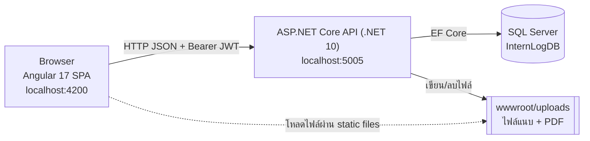
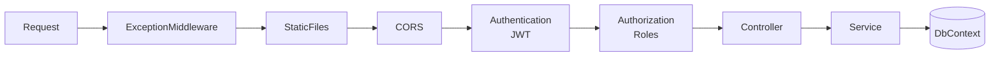
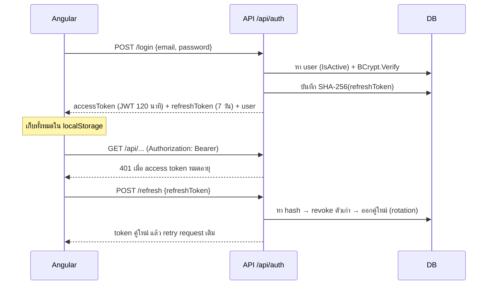
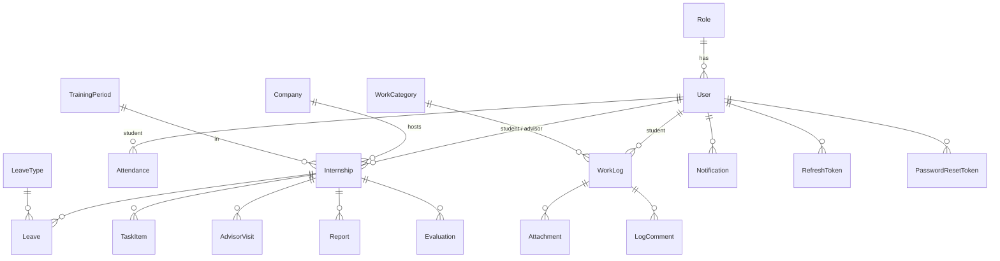

# สถาปัตยกรรมระบบ (Architecture)

เอกสารนี้อธิบายโครงสร้างตาม **โค้ดปัจจุบัน** (12 พ.ย. 2569) สำหรับเหตุผลเบื้องหลังการออกแบบดู [reference/design-decisions.md](reference/design-decisions.md)

## 1. ภาพรวม



| ชั้น | เทคโนโลยีหลัก |
|---|---|
| Frontend | Angular 17 standalone components, Signals, RxJS, `date-fns`, `jwt-decode` |
| Backend | ASP.NET Core Web API, EF Core (SQL Server), JWT Bearer, BCrypt.Net, QuestPDF, Swashbuckle |
| Database | SQL Server, schema จัดการด้วย EF Core Migrations (`InternLog.API/Migrations/`) |

## 2. Backend (`InternLog.API/`)

### 2.1 โครงสร้างโฟลเดอร์

```
InternLog.API/
├── Program.cs                 # DI, JWT, CORS, Swagger, middleware pipeline, dev seed
├── appsettings.json           # connection string, JWT issuer/audience (key อยู่ใน user-secrets)
├── Migrations/                # EF Core migrations
└── src/
    ├── Core/                  # ของที่ใช้ร่วมกันทุกโมดูล
    │   ├── Common/            # ApiResponse<T>, AppException, AppControllerBase, Constants
    │   ├── Interfaces/        # ICurrentUserService
    │   └── Security/          # CurrentUserService, PasswordHasher (BCrypt), Sha256Hasher
    ├── Infrastructure/
    │   ├── Data/              # AppDbContext (Fluent config + HasData), Models/Entities.cs
    │   └── Middleware/        # ExceptionMiddleware
    └── Modules/               # แยกตามฟีเจอร์
        ├── Auth/  Attendance/  Leaves/  WorkLogs/  Tasks/
        ├── AdvisorVisits/  Reports/  Evaluations/  Notifications/
        └── Dashboard/  Admin/  Companies/
```

### 2.2 รูปแบบของแต่ละโมดูล

ทุกโมดูล (ยกเว้น Companies) มีโครงเดียวกัน:

```
Modules/<Name>/
├── <Name>Controller.cs   # รับ request, ตรวจ role ด้วย [Authorize(Roles=...)], ห่อผลด้วย ApiResponse
├── I<Name>Service.cs     # interface
├── <Name>Service.cs      # business logic + ตรวจสิทธิ์ระดับข้อมูล + query ผ่าน AppDbContext
└── DTOs/                 # request/response records
```

Service ลงทะเบียนใน `Program.cs` แบบ `AddScoped<IXService, XService>()`
`CompaniesController` เป็นข้อยกเว้น — query `AppDbContext` ตรงใน controller

### 2.3 Request pipeline



### 2.4 Response และ error

ทุก endpoint ตอบในรูปแบบเดียวกัน (`Core/Common/ApiResponse.cs`):

```json
{ "success": true, "message": "สำเร็จ", "data": { } }
```

- Service โยน `AppException` (`BadRequest`, `Unauthorized`, `Forbidden`, `NotFound`, `Conflict`) → `ExceptionMiddleware` แปลงเป็น status code + `success: false`
- Exception อื่น → 500 โดยซ่อนรายละเอียดเมื่อไม่ใช่ Development
- 401/403 จาก JWT ตอบเป็น JSON ภาษาไทยผ่าน `JwtBearerEvents` ใน `Program.cs`

### 2.5 การตรวจสิทธิ์ 2 ชั้น

1. **ระดับ endpoint (RBAC)** — `[Authorize(Roles = "student,advisor")]` บน controller/action
2. **ระดับข้อมูล (กัน IDOR)** — ใน service ใช้ `ICurrentUserService` (อ่าน `sub`/role จาก JWT) แล้วตรวจ:
   - **student** เข้าถึงได้เฉพาะข้อมูลที่ `StudentID == ตัวเอง`
   - **advisor** เข้าถึงได้เฉพาะนักศึกษาที่มี `Internship.AdvisorID == ตัวเอง`
   - **admin** เข้าถึงได้ทั้งหมด

## 3. Authentication



| เรื่อง | รายละเอียด |
|---|---|
| Access token | JWT HS256, อายุ 120 นาที, claims: `sub` (UserID), `name`, role, `jti` · `ClockSkew = 0` |
| Refresh token | 64 bytes สุ่ม, เก็บใน DB เป็น SHA-256 hash, อายุ 7 วัน, หมุนทุกครั้งที่ใช้ (`ReplacedByTokenID`) |
| Password | BCrypt work factor 12 |
| Reset password | token สุ่ม 64 bytes, เก็บเป็น SHA-256, อายุ 1 ชั่วโมง, ใช้ได้ครั้งเดียว |
| เปลี่ยน/รีเซ็ตรหัสผ่าน | revoke refresh token ทั้งหมดของ user |
| สมัครสมาชิก | ได้เฉพาะ role `student` |

ฝั่งเว็บ: `core/interceptors/auth.interceptor.ts` แนบ Bearer token, ถ้า token หมดอายุหรือได้ 401 จะ refresh **ครั้งเดียว** ร่วมกันทุก request (shared observable) แล้ว retry

## 4. ข้อมูล (Database)

19 ตาราง (entity ทั้งหมดอยู่ใน `src/Infrastructure/Data/Models/Entities.cs`)



แกนกลางของระบบคือ **`Internship`** (นักศึกษา 1 คน + อาจารย์ 1 คน + บริษัท + ภาคเรียน) — สิทธิ์ของ advisor คำนวณผ่านตารางนี้
`Attendance` และ `WorkLog` ผูกกับ `StudentID` โดยตรง ส่วน `Leave`, `TaskItem`, `AdvisorVisit`, `Report`, `Evaluation` ผูกกับ `InternshipID`

ข้อมูลตั้งต้น (`HasData`): roles (`student`, `advisor`, `supervisor`, `admin`), ประเภทการลา 3 แบบ, หมวดงาน 5 หมวด, admin 1 คน

ค่าสถานะที่ใช้ทั้งระบบอยู่ใน `Core/Common/Constants.cs` (attendance, leave, task, report, internship status)

## 5. Frontend (`InternLog.Web/`)

```
src/app/
├── app.routes.ts          # route ทั้งหมด (lazy loadComponent)
├── app.config.ts          # provideRouter, provideHttpClient(withInterceptors)
├── core/
│   ├── auth/              # AuthService (signals: currentUser, isAuthenticated)
│   ├── guards/            # authGuard, roleGuard (data.roles)
│   ├── interceptors/      # authInterceptor (Bearer + refresh)
│   └── services/          # service เรียก API ของแต่ละโมดูล
├── layout/                # shell, sidebar (เมนูตาม role), topbar
├── features/<feature>/    # หน้าจอแยกตามฟีเจอร์ (บางฟีเจอร์มี services/ models/ ของตัวเอง)
└── models/                # interface ที่ใช้ร่วมกัน
```

### 5.1 Routes และสิทธิ์

ทุกหน้าใต้ `ShellComponent` ต้องผ่าน `authGuard` หน้าที่จำกัด role ใช้ `roleGuard`

| Path | หน้าที่ | Role (guard) | เมนู sidebar แสดงให้ |
|---|---|---|---|
| `/login`, `/register`, `/forgot-password` | Auth | ไม่ต้อง login | — |
| `/dashboard` | สรุปภาพรวม | ทุก role | ทุก role |
| `/attendance` | ลงเวลา/ประวัติ | ทุก role | ทุก role |
| `/leaves` | ใบลา | ทุก role | ทุก role |
| `/calendar` | ปฏิทิน | ทุก role | ทุก role |
| `/work-logs`, `/work-logs/new`, `/work-logs/:id` | บันทึกงานรายวัน | ทุก role | student, advisor |
| `/tasks` | Kanban งานที่มอบหมาย | ทุก role | ทุก role |
| `/visits` | การนิเทศ | ทุก role | ทุก role |
| `/reports`, `/reports/:id/preview` | รายงาน | ทุก role | ทุก role |
| `/evaluations` | การประเมิน | ทุก role | student, advisor |
| `/notifications`, `/profile` | แจ้งเตือน / โปรไฟล์ | ทุก role | ทุก role |
| `/companies` | บริษัทที่ดูแล | advisor, admin | advisor |
| `/admin/users`, `/admin/companies`, `/admin/internships` | จัดการระบบ | admin | admin |

> การซ่อนเมนูเป็นแค่ UX — การป้องกันจริงอยู่ที่ API (ข้อ 2.5)

### 5.2 การเรียก API

- Base URL: `environment.apiUrl` (`http://localhost:5005/api`)
- ทุก service คืน `Observable<ApiResponse<T>>` ตรงกับ format ฝั่ง API
- Service หลักที่หน้าจอใช้อยู่ใน `core/services/` — มี service ซ้ำบางตัวใน `features/*/services/` (ดู [project-status.md](project-status.md))

## 6. ไฟล์อัปโหลด

| ประเภท | ตำแหน่งที่เก็บ | สร้างโดย |
|---|---|---|
| ไฟล์แนบใบลา | `wwwroot/uploads/leaves/` | `LeaveService.SubmitLeaveAsync` |
| ไฟล์แนบ Work Log | `wwwroot/uploads/worklogs/` | `WorkLogService.UploadAttachmentAsync` (ตรวจขนาด ≤ 5 MB, นามสกุล, magic bytes) |
| PDF รายงาน | `wwwroot/uploads/reports/` | `ReportService.ExportPdfAsync` (QuestPDF) |

DB เก็บ path แบบ relative (`/uploads/...`) และไฟล์ถูกเสิร์ฟผ่าน `UseStaticFiles()` โดย **ไม่ตรวจสิทธิ์** — ดูความเสี่ยงใน [project-status.md](project-status.md)
