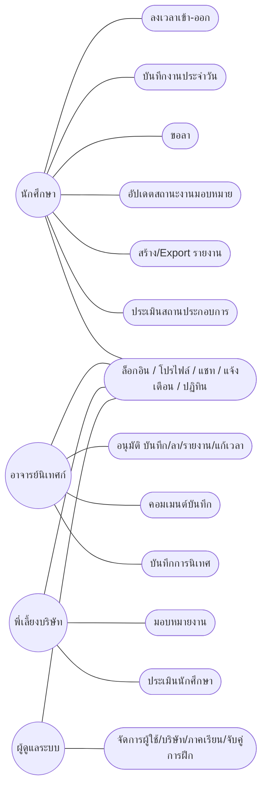
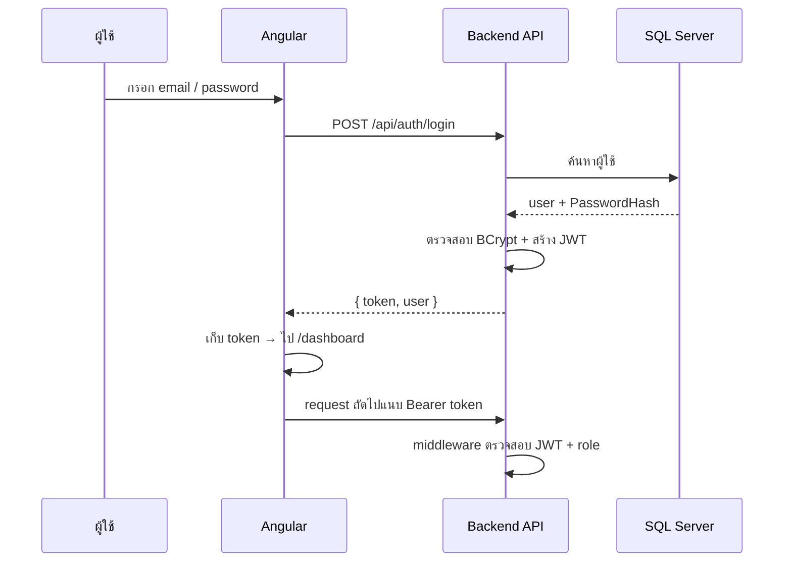
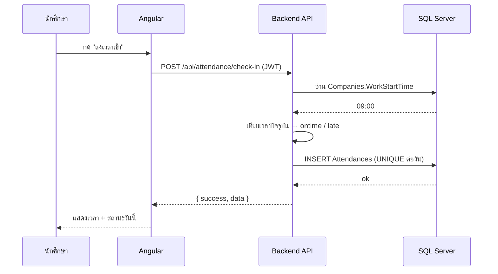
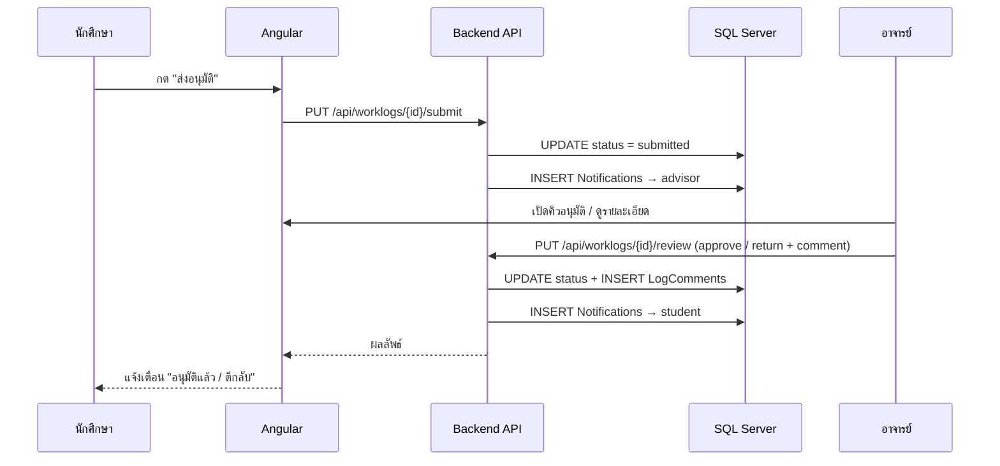

# 📐 ระบบจดบันทึกการฝึกงาน — เอกสารส่วนที่ 3
> Use Case + SRS | Sequence Diagram | สคริปต์ฐานข้อมูล (SQL)
> จัดทำเมื่อ 14 สิงหาคม 2569 | ชื่อไฟล์แนะนำ: `internship-log-analysis-sql.md`
>
> **แผนที่เอกสารทั้งชุด**
> - ส่วนที่ 1 `internship-log-system-docs.md` → โครงสร้างระบบ + ERD + Backend
> - ส่วนที่ 2 `internship-log-ui-design.md` → UI Design ทั้ง 20 หน้า
> - ส่วนที่ 3 `internship-log-analysis-sql.md` → เอกสารฉบับนี้ (Analysis + Design เสริม + SQL)

---

## 1. Use Case Diagram



### Use Case Description (ย่อ)

| UC | ชื่อ | Actor | Include / Extend |
|---|---|---|---|
| 01 | ล็อกอิน | ทุกคน | include สร้าง JWT • extend ลืมรหัสผ่าน |
| 02 | ลงเวลาเข้า-ออก | student | include คำนวณ ชม.+ตัดสาย • extend ขอแก้เวลา |
| 03 | บันทึกงานประจำวัน | student | include แนบไฟล์ |
| 04 | ส่งบันทึกอนุมัติ | student | include แจ้งเตือนอาจารย์ |
| 05 | อนุมัติ/ตีกลับ | advisor | ใช้กับ บันทึก/ลา/รายงาน/แก้เวลา • include แจ้งเตือน นศ. |
| 06 | ขอลา | student | include เช็กโควตา • extend แนบใบรับรองแพทย์ |
| 07 | งานมอบหมาย | supervisor, advisor / student | กระดาน Kanban |
| 08 | บันทึกการนิเทศ | advisor | คนที่/ครั้งที่/วันที่/คะแนน |
| 09 | รายงาน | student | include รวมข้อมูลอัตโนมัติ • extend Export PDF |
| 10 | แชท/แจ้งเตือน | ทุกคน | |
| 11 | ประเมิน 2 ทาง | supervisor ↔ student | |
| 12 | จัดการระบบ | admin | |
| 13 | ปฏิทิน/แดชบอร์ด | student, advisor | รวมสถานะรายวัน |

---

## 2. SRS ฉบับกระชับ

### 2.1 Functional Requirements (FR)
| ID | ข้อกำหนด |
|---|---|
| FR-01 | ล็อกอิน/JWT/เปลี่ยนรหัส/จัดการโปรไฟล์ |
| FR-02 | ลงเวลาเข้า-ออก, คำนวณชั่วโมงอัตโนมัติ, ตัดสถานะสาย, ขอแก้เวลา |
| FR-03 | ขอลา + เช็กโควตา + อนุมัติ/ไม่อนุมัติ |
| FR-04 | บันทึกงาน CRUD + สถานะ draft→submitted→approved/returned + แนบไฟล์ + คอมเมนต์ |
| FR-05 | มอบหมายงาน + Kanban |
| FR-06 | บันทึกการนิเทศ (คนที่/ครั้งที่/วันที่/อาจารย์/คะแนน) |
| FR-07 | รายงานอัตโนมัติรายสัปดาห์/เดือน + อนุมัติ + Export PDF |
| FR-08 | แชท 1:1 + แจ้งเตือนอัตโนมัติ |
| FR-09 | ประเมิน 2 ทาง |
| FR-10 | Admin: ผู้ใช้/บริษัท/ภาคเรียน/จับคู่การฝึก |
| FR-11 | แดชบอร์ด + ปฏิทินสีสถานะ แยกตาม role |

### 2.2 Non-Functional Requirements (NFR)
| ด้าน | ข้อกำหนด |
|---|---|
| Performance | หน้าหลักโหลด < 3 วินาที, รองรับผู้ใช้พร้อมกัน ≥ 200 |
| Security | BCrypt, JWT หมดอายุ 8 ชม., RBAC, HTTPS, จำกัดชนิด/ขนาดไฟล์อัปโหลด |
| Usability | ไทยทั้งระบบ, desktop-first (≥1024px), flow หลักไม่เกิน 3 คลิก |
| Reliability | Backup DB อัตโนมัติรายวัน, กู้คืนได้ภายใน 1 ชม. |
| Availability | ≥ 99% ในช่วงเวลาทำการ |
| Maintainability | Layered architecture, Swagger docs, coding standards ทีม |
| Compatibility | Chrome/Edge/Firefox เวอร์ชันล่าสุด, SQL Server 2019+ |

### 2.3 PDPA และความเป็นส่วนตัว
- Consent checkbox ตอนสมัคร/ล็อกอินครั้งแรก + หน้า Privacy Policy
- ข้อมูลเข้าถึงได้เฉพาะผู้เกี่ยวข้องตาม RBAC
- ลบ/ทำลายข้อมูลเมื่อร้องขอ หรือครบกำหนดอายุการเก็บ

### 2.4 ข้อจำกัด (Constraints)
- ต้องใช้ Angular (frontend) + SQL Server ผ่าน SSMS (ตามข้อกำหนดรายวิชา)
- Backend เลือก ASP.NET Core Web API + EF Core
- ทีมพัฒนาต้องทำตาม coding standards และ Git workflow ที่กำหนด

---

## 3. Sequence Diagram 3 Flow หลัก

### 3.1 ล็อกอิน / JWT


### 3.2 ลงเวลา (ตัดสายอัตโนมัติ)


### 3.3 ส่งบันทึก → อาจารย์อนุมัติ


---

## 4. สคริปต์ฐานข้อมูล (รันใน SSMS)

> วิธีใช้: เปิด SSMS → New Query → วางสคริปต์ทั้งชุด → Execute
> ผลลัพธ์: เกิดฐานข้อมูล `InternLogDB` พร้อม 18 ตาราง + Index + Seed data

```sql
-- =============================================
-- InternLogDB : ระบบจดบันทึกการฝึกงาน (18 ตาราง)
-- =============================================
IF DB_ID('InternLogDB') IS NULL CREATE DATABASE InternLogDB;
GO
USE InternLogDB;
GO

CREATE TABLE Roles (
  RoleID INT IDENTITY(1,1) PRIMARY KEY,
  RoleName NVARCHAR(50) NOT NULL
);

CREATE TABLE Users (
  UserID INT IDENTITY(1,1) PRIMARY KEY,
  RoleID INT NOT NULL REFERENCES Roles(RoleID),
  Email NVARCHAR(100) NOT NULL UNIQUE,
  PasswordHash NVARCHAR(255) NOT NULL,
  FirstName NVARCHAR(100) NOT NULL,
  LastName NVARCHAR(100) NOT NULL,
  StudentID NVARCHAR(20) NULL,
  Phone NVARCHAR(20) NULL,
  IsActive BIT NOT NULL DEFAULT 1,
  CreatedAt DATETIME NOT NULL DEFAULT GETDATE()
);

CREATE TABLE Companies (
  CompanyID INT IDENTITY(1,1) PRIMARY KEY,
  Name NVARCHAR(200) NOT NULL,
  Address NVARCHAR(500) NULL,
  Phone NVARCHAR(20) NULL,
  WorkStartTime TIME NOT NULL DEFAULT '09:00',
  WorkEndTime TIME NOT NULL DEFAULT '18:00'
);

CREATE TABLE TrainingPeriods (
  PeriodID INT IDENTITY(1,1) PRIMARY KEY,
  PeriodName NVARCHAR(100) NOT NULL,
  StartDate DATE NOT NULL,
  EndDate DATE NOT NULL,
  IsActive BIT NOT NULL DEFAULT 1
);

CREATE TABLE Internships (
  InternshipID INT IDENTITY(1,1) PRIMARY KEY,
  StudentID INT NOT NULL REFERENCES Users(UserID),
  CompanyID INT NOT NULL REFERENCES Companies(CompanyID),
  AdvisorID INT NOT NULL REFERENCES Users(UserID),
  SupervisorID INT NULL REFERENCES Users(UserID),
  PeriodID INT NOT NULL REFERENCES TrainingPeriods(PeriodID),
  StartDate DATE NOT NULL,
  EndDate DATE NOT NULL,
  RequiredDays INT NOT NULL DEFAULT 60,
  RequiredHours INT NOT NULL DEFAULT 480,
  Status NVARCHAR(20) NOT NULL DEFAULT 'active'
);

CREATE TABLE Attendances (
  AttendanceID INT IDENTITY(1,1) PRIMARY KEY,
  StudentID INT NOT NULL REFERENCES Users(UserID),
  AttDate DATE NOT NULL,
  CheckInTime TIME NULL,
  CheckOutTime TIME NULL,
  TotalHours DECIMAL(5,2) NULL,
  Status NVARCHAR(20) NOT NULL DEFAULT 'ontime',
  Note NVARCHAR(500) NULL,
  CONSTRAINT UQ_Attendance_Daily UNIQUE (StudentID, AttDate)
);

CREATE TABLE LeaveTypes (
  LeaveTypeID INT IDENTITY(1,1) PRIMARY KEY,
  TypeName NVARCHAR(50) NOT NULL,
  MaxDays INT NOT NULL
);

CREATE TABLE Leaves (
  LeaveID INT IDENTITY(1,1) PRIMARY KEY,
  StudentID INT NOT NULL REFERENCES Users(UserID),
  LeaveTypeID INT NOT NULL REFERENCES LeaveTypes(LeaveTypeID),
  StartDate DATE NOT NULL,
  EndDate DATE NOT NULL,
  TotalDays DECIMAL(4,1) NOT NULL,
  Reason NVARCHAR(500) NOT NULL,
  AttachmentPath NVARCHAR(255) NULL,
  Status NVARCHAR(20) NOT NULL DEFAULT 'pending',
  ApprovedBy INT NULL REFERENCES Users(UserID),
  ApprovedAt DATETIME NULL,
  CreatedAt DATETIME NOT NULL DEFAULT GETDATE()
);

CREATE TABLE WorkCategories (
  CategoryID INT IDENTITY(1,1) PRIMARY KEY,
  CategoryName NVARCHAR(100) NOT NULL
);

CREATE TABLE WorkLogs (
  LogID INT IDENTITY(1,1) PRIMARY KEY,
  StudentID INT NOT NULL REFERENCES Users(UserID),
  LogDate DATE NOT NULL,
  Title NVARCHAR(200) NOT NULL,
  Description NVARCHAR(MAX) NOT NULL,
  Problem NVARCHAR(MAX) NULL,
  Solution NVARCHAR(MAX) NULL,
  CategoryID INT NULL REFERENCES WorkCategories(CategoryID),
  Hours DECIMAL(5,2) NULL,
  Status NVARCHAR(20) NOT NULL DEFAULT 'draft',
  CreatedAt DATETIME NOT NULL DEFAULT GETDATE(),
  UpdatedAt DATETIME NULL
);

CREATE TABLE Attachments (
  AttachmentID INT IDENTITY(1,1) PRIMARY KEY,
  LogID INT NOT NULL REFERENCES WorkLogs(LogID),
  FileName NVARCHAR(255) NOT NULL,
  FilePath NVARCHAR(500) NOT NULL,
  FileType NVARCHAR(20) NULL,
  FileSize BIGINT NULL,
  UploadedAt DATETIME NOT NULL DEFAULT GETDATE()
);

CREATE TABLE LogComments (
  CommentID INT IDENTITY(1,1) PRIMARY KEY,
  LogID INT NOT NULL REFERENCES WorkLogs(LogID),
  UserID INT NOT NULL REFERENCES Users(UserID),
  Message NVARCHAR(MAX) NOT NULL,
  CreatedAt DATETIME NOT NULL DEFAULT GETDATE()
);

CREATE TABLE Tasks (
  TaskID INT IDENTITY(1,1) PRIMARY KEY,
  InternID INT NOT NULL REFERENCES Users(UserID),
  AssignedBy INT NOT NULL REFERENCES Users(UserID),
  Title NVARCHAR(200) NOT NULL,
  Detail NVARCHAR(MAX) NULL,
  DueDate DATE NULL,
  Priority NVARCHAR(10) NOT NULL DEFAULT 'medium',
  Status NVARCHAR(20) NOT NULL DEFAULT 'todo',
  CreatedAt DATETIME NOT NULL DEFAULT GETDATE()
);

CREATE TABLE AdvisorVisits (
  VisitID INT IDENTITY(1,1) PRIMARY KEY,
  InternshipID INT NOT NULL REFERENCES Internships(InternshipID),
  PersonNo INT NOT NULL,
  VisitNo INT NOT NULL,
  VisitDate DATE NOT NULL,
  AdvisorID INT NOT NULL REFERENCES Users(UserID),
  Method NVARCHAR(20) NOT NULL DEFAULT 'onsite',
  Summary NVARCHAR(MAX) NULL,
  Score DECIMAL(5,2) NULL,
  CreatedAt DATETIME NOT NULL DEFAULT GETDATE()
);

CREATE TABLE Messages (
  MessageID INT IDENTITY(1,1) PRIMARY KEY,
  SenderID INT NOT NULL REFERENCES Users(UserID),
  ReceiverID INT NOT NULL REFERENCES Users(UserID),
  Content NVARCHAR(MAX) NOT NULL,
  IsRead BIT NOT NULL DEFAULT 0,
  SentAt DATETIME NOT NULL DEFAULT GETDATE()
);

CREATE TABLE Notifications (
  NotificationID INT IDENTITY(1,1) PRIMARY KEY,
  UserID INT NOT NULL REFERENCES Users(UserID),
  Message NVARCHAR(500) NOT NULL,
  RelatedType NVARCHAR(50) NULL,
  RelatedID INT NULL,
  IsRead BIT NOT NULL DEFAULT 0,
  CreatedAt DATETIME NOT NULL DEFAULT GETDATE()
);

CREATE TABLE Reports (
  ReportID INT IDENTITY(1,1) PRIMARY KEY,
  StudentID INT NOT NULL REFERENCES Users(UserID),
  ReportType NVARCHAR(20) NOT NULL DEFAULT 'weekly',
  StartDate DATE NOT NULL,
  EndDate DATE NOT NULL,
  Summary NVARCHAR(MAX) NULL,
  Status NVARCHAR(20) NOT NULL DEFAULT 'draft',
  ApprovedBy INT NULL REFERENCES Users(UserID),
  CreatedAt DATETIME NOT NULL DEFAULT GETDATE()
);

CREATE TABLE Evaluations (
  EvaluationID INT IDENTITY(1,1) PRIMARY KEY,
  InternshipID INT NOT NULL REFERENCES Internships(InternshipID),
  EvaluatorID INT NOT NULL REFERENCES Users(UserID),
  EvalType NVARCHAR(50) NOT NULL,
  TotalScore DECIMAL(5,2) NULL,
  Comment NVARCHAR(MAX) NULL,
  EvaluatedAt DATETIME NOT NULL DEFAULT GETDATE()
);
GO

-- ===== Index เพิ่มประสิทธิภาพ =====
CREATE INDEX IX_WorkLogs_Student_Date ON WorkLogs(StudentID, LogDate);
CREATE INDEX IX_Messages_Pair ON Messages(SenderID, ReceiverID);
CREATE INDEX IX_Notifications_User ON Notifications(UserID, IsRead);
GO

-- ===== Seed Data =====
INSERT INTO Roles (RoleName) VALUES
(N'student'), (N'advisor'), (N'supervisor'), (N'admin');

INSERT INTO LeaveTypes (TypeName, MaxDays) VALUES
(N'ลาป่วย', 30), (N'ลากิจ', 3), (N'ลาพักร้อน', 6);

INSERT INTO WorkCategories (CategoryName) VALUES
(N'Development'), (N'Meeting'), (N'Documentation'), (N'Testing'), (N'อื่น ๆ');
GO
-- หมายเหตุ: ผู้ใช้คนแรก (admin) ให้ seed ผ่านแอปด้วย BCrypt hash จริง
-- ไม่ควรเก็บรหัส plaintext ในสคริปต์ (ความปลอดภัย)
```

---

## 5. งานที่เหลือตาม SDLC (TODO ถัดไป)

- [ ] รันสคริปต์ SQL ใน SSMS + ตรวจสอบ Diagram ครบ 18 ตาราง
- [ ] ตั้ง Git repo + branch strategy (main / develop / feature/*)
- [ ] สร้างโปรเจกต์ API + Angular → เริ่มโค้ดส่วน Auth
- [ ] เขียน Test plan / Test cases รายโมดูล + UAT plan
- [ ] แผน Deployment (server, HTTPS, CI/CD) + backup/restore
- [ ] คู่มือผู้ใช้ราย role + คู่มือผู้ดูแลระบบ