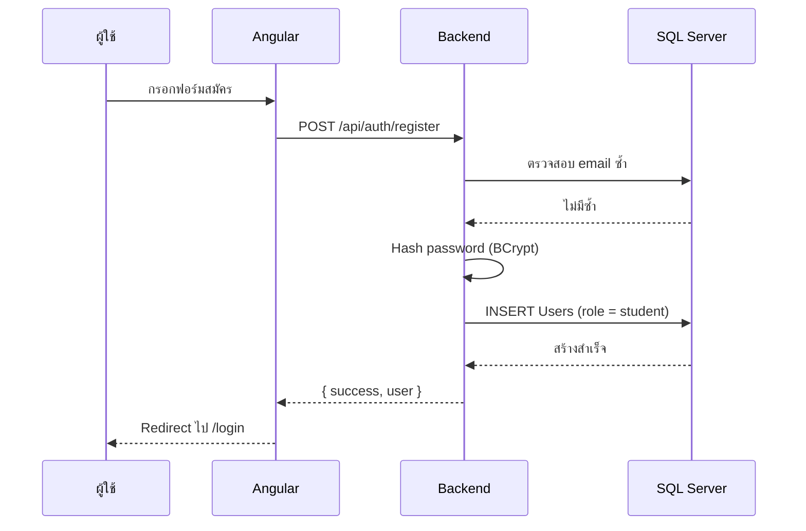
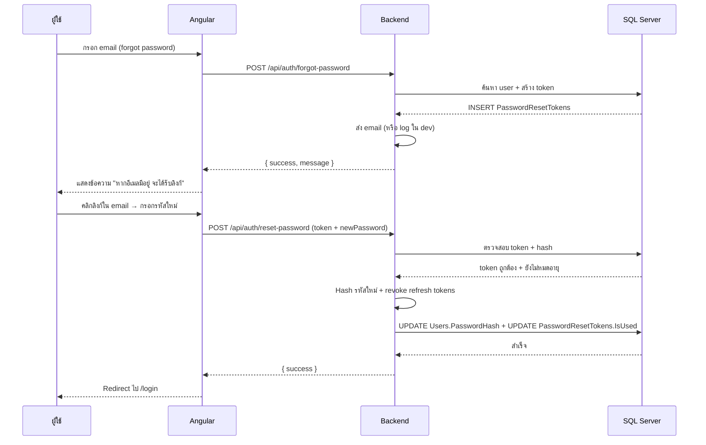

#  ระบบจดบันทึกการฝึกงาน — เอกสารส่วนที่ 7
> แก้ไขช่องว่าง Auth: Register + Forgot/Reset Password
> จัดทำเมื่อ 14 สิงหาคม 2569 | ชื่อไฟล์แนะนำ: `internship-log-auth-gap-fix.md`
>
> **ที่มา:** จากการตรวจสอบความสอดคล้องระหว่าง UI (ส่วนที่ 6) และ Backend (ส่วนที่ 1) พบ 2 จุดที่ UI มีแต่ Backend ไม่มี endpoint รองรับ

---

## 1. สรุปปัญหาที่พบ

| # | หน้า UI (ส่วนที่ 6) | Endpoint ที่ขาดใน Backend (ส่วนที่ 1) |
|---|---|---|
| 1 | **S2 Register** — ฟอร์มสมัครสมาชิก | ไม่มี `POST /api/auth/register` (เอกสารเดิมระบุว่า "admin เพิ่มให้" แต่ UI มีหน้า register) |
| 2 | **S3 Forgot Password** — ฟอร์มส่ง email รีเซ็ต | ไม่มี endpoint สำหรับ reset password เลย |

**ผลกระทบ:** หากไม่แก้ → หน้า Register และ Forgot Password ใน Angular จะเรียก API ไม่ได้ → ฟีเจอร์ไม่สมบูรณ์

---

## 2. การแก้ไข Backend (เพิ่ม Endpoints)

### 2.1 เพิ่มใน `AuthController.cs`

```csharp
// POST /api/auth/register
[HttpPost("register")]
public async Task<IActionResult> Register([FromBody] RegisterRequest req) {
  if (!ModelState.IsValid)
    return BadRequest(new ApiResponse<object>(false, "ข้อมูลไม่ถูกต้อง", null));
  
  // ตรวจสอบว่า email ซ้ำหรือไม่
  if (await _userService.EmailExistsAsync(req.Email))
    return Conflict(new ApiResponse<object>(false, "อีเมลนี้ถูกใช้งานแล้ว", null));
  
  // สร้าง user ใหม่ (role = student โดย default หรือรับจาก req.Role ถ้าเป็น admin)
  var user = await _userService.RegisterAsync(req);
  return Ok(new ApiResponse<object>(true, "สมัครสมาชิกสำเร็จ", user));
}

// POST /api/auth/forgot-password
[HttpPost("forgot-password")]
public async Task<IActionResult> ForgotPassword([FromBody] ForgotPasswordRequest req) {
  // ไม่บอกว่า email มีอยู่จริงหรือไม่ (กัน user enumeration)
  await _userService.SendPasswordResetEmailAsync(req.Email);
  return Ok(new ApiResponse<object>(true, "หากอีเมลมีอยู่ในระบบ จะได้รับลิงก์รีเซ็ตรหัสผ่าน", null));
}

// POST /api/auth/reset-password
[HttpPost("reset-password")]
public async Task<IActionResult> ResetPassword([FromBody] ResetPasswordRequest req) {
  var success = await _userService.ResetPasswordAsync(req.Token, req.NewPassword);
  if (!success)
    return BadRequest(new ApiResponse<object>(false, "ลิงก์ไม่ถูกต้องหรือหมดอายุ", null));
  
  return Ok(new ApiResponse<object>(true, "รีเซ็ตรหัสผ่านสำเร็จ กรุณาล็อกอินใหม่", null));
}
```

### 2.2 เพิ่ม DTOs ใน `AuthDtos.cs`

```csharp
// Register
public record RegisterRequest(
  [Required][EmailAddress] string Email,
  [Required][MinLength(8)] string Password,
  [Required] string FirstName,
  [Required] string LastName,
  string? StudentID,
  string? Phone,
  string Role = "student"  // default = student, admin สามารถส่ง role อื่นได้
);

// Forgot Password
public record ForgotPasswordRequest(
  [Required][EmailAddress] string Email
);

// Reset Password
public record ResetPasswordRequest(
  [Required] string Token,
  [Required][MinLength(8)] string NewPassword
);
```

### 2.3 เพิ่ม Methods ใน `AuthService.cs` (หรือแยก UserService)

```csharp
public interface IAuthService {
  // ... methods เดิม ...
  Task<UserDto> RegisterAsync(RegisterRequest req);
  Task<bool> EmailExistsAsync(string email);
  Task SendPasswordResetEmailAsync(string email);
  Task<bool> ResetPasswordAsync(string token, string newPassword);
}

// Implementation (ย่อ)
public async Task<UserDto> RegisterAsync(RegisterRequest req) {
  var role = await _db.Roles.FirstAsync(r => r.RoleName == req.Role);
  var user = new User {
    RoleID = role.RoleID,
    Email = req.Email,
    PasswordHash = BCrypt.Net.BCrypt.HashPassword(req.Password),
    FirstName = req.FirstName,
    LastName = req.LastName,
    StudentID = req.StudentID,
    Phone = req.Phone,
    IsActive = true,
    CreatedAt = DateTime.Now
  };
  _db.Users.Add(user);
  await _db.SaveChangesAsync();
  return ToDto(user);
}

public async Task SendPasswordResetEmailAsync(string email) {
  var user = await _db.Users.FirstOrDefaultAsync(u => u.Email == email);
  if (user == null) return;  // ไม่ throw error (กัน user enumeration)
  
  // สร้าง token (random string)
  var token = Convert.ToBase64String(RandomNumberGenerator.GetBytes(64));
  var tokenHash = BCrypt.Net.BCrypt.HashPassword(token);
  
  var resetToken = new PasswordResetToken {
    UserID = user.UserID,
    TokenHash = tokenHash,
    ExpiresAt = DateTime.UtcNow.AddHours(1),  // หมดอายุใน 1 ชม.
    IsUsed = false,
    CreatedAt = DateTime.Now
  };
  _db.PasswordResetTokens.Add(resetToken);
  await _db.SaveChangesAsync();
  
  // ส่ง email (ในโปรเจกต์นี้จำลองด้วยการ log หรือ return token ใน response สำหรับ dev)
  // TODO: ใช้ EmailService จริงใน production
  Console.WriteLine($"[DEV] Reset link: http://localhost:4200/reset-password?token={token}");
}

public async Task<bool> ResetPasswordAsync(string token, string newPassword) {
  var tokenHash = BCrypt.Net.BCrypt.HashPassword(token);  // hash เพื่อเทียบ
  var resetToken = await _db.PasswordResetTokens
    .FirstOrDefaultAsync(t => t.TokenHash == tokenHash && !t.IsUsed && t.ExpiresAt > DateTime.UtcNow);
  
  if (resetToken == null) return false;
  
  var user = await _db.Users.FindAsync(resetToken.UserID);
  if (user == null) return false;
  
  user.PasswordHash = BCrypt.Net.BCrypt.HashPassword(newPassword);
  resetToken.IsUsed = true;
  
  // Revoke refresh tokens ทั้งหมด (บังคับ login ใหม่)
  var refreshTokens = await _db.RefreshTokens.Where(rt => rt.UserID == user.UserID && rt.RevokedAt == null).ToListAsync();
  refreshTokens.ForEach(rt => rt.RevokedAt = DateTime.UtcNow);
  
  await _db.SaveChangesAsync();
  return true;
}
```

---

## 3. การแก้ไข Database (เพิ่มตาราง)

### 3.1 เพิ่มตาราง `PasswordResetTokens`

```sql
-- ===== ตารางที่ 20: PasswordResetTokens (เพิ่มใหม่) =====
CREATE TABLE PasswordResetTokens (
  TokenID INT IDENTITY(1,1) PRIMARY KEY,
  UserID INT NOT NULL REFERENCES Users(UserID),
  TokenHash NVARCHAR(255) NOT NULL,
  ExpiresAt DATETIME NOT NULL,
  IsUsed BIT NOT NULL DEFAULT 0,
  CreatedAt DATETIME NOT NULL DEFAULT GETDATE()
);
CREATE INDEX IX_PasswordResetTokens_User ON PasswordResetTokens(UserID);
CREATE INDEX IX_PasswordResetTokens_Hash ON PasswordResetTokens(TokenHash);
GO
```

### 3.2 อัปเดต Entity ใน `AppDbContext.cs`

```csharp
public DbSet<PasswordResetToken> PasswordResetTokens => Set<PasswordResetToken>();

// ใน OnModelCreating
mb.Entity<PasswordResetToken>(e => {
  e.ToTable("PasswordResetTokens");
  e.HasKey(x => x.TokenID);
  e.HasIndex(x => x.TokenHash);
});
```

### 3.3 เพิ่ม Model `PasswordResetToken.cs`

```csharp
namespace InternLog.API.Models;
public class PasswordResetToken {
  public int TokenID { get; set; }
  public int UserID { get; set; }
  public string TokenHash { get; set; } = "";
  public DateTime ExpiresAt { get; set; }
  public bool IsUsed { get; set; }
  public DateTime CreatedAt { get; set; }
  public User User { get; set; } = null!;
}
```

---

## 4. เช็กลิสต์การอัปเดตเอกสารเดิม

### ส่วนที่ 1 (`internship-log-system-docs.md`)
- [ ] เพิ่ม endpoint `POST /api/auth/register` ในตาราง Auth endpoints
- [ ] เพิ่ม endpoint `POST /api/auth/forgot-password` และ `POST /api/auth/reset-password`
- [ ] เพิ่มตาราง `PasswordResetTokens` ใน ERD (ตารางที่ 20)
- [ ] เพิ่มความสัมพันธ์ `Users ─< PasswordResetTokens`

### ส่วนที่ 3 (`internship-log-analysis-sql.md`)
- [ ] เพิ่ม `CREATE TABLE PasswordResetTokens` ในสคริปต์ SQL
- [ ] เพิ่ม indexes (UserID, TokenHash)

### ส่วนที่ 4 (`internship-log-review-decisions.md`)
- [ ] บันทึกรายการแก้ไขนี้ (เพิ่มเป็นรายการ #6 และ #7)

### ส่วนที่ 6 (`internship-log-figma-checklist.md`)
- [ ] ไม่มีผล (UI มีอยู่แล้ว)

---

## 5. Flow การทำงาน (Sequence Diagram)

### 5.1 Register Flow


### 5.2 Forgot/Reset Password Flow


---

## 6. Security Considerations

1. **User Enumeration Prevention:** 
   - `forgot-password` ไม่บอกว่า email มีอยู่จริงหรือไม่ (return message เดียวกันเสมอ)
   - `register` บอกเฉพาะกรณี email ซ้ำ (เพราะต้องป้องกัน duplicate)

2. **Token Security:**
   - เก็บเฉพาะ `TokenHash` (BCrypt) ไม่เก็บ token ตรงๆ
   - Token หมดอายุใน 1 ชม.
   - ใช้แล้วลบ (IsUsed = true)
   - Revoke refresh tokens ทั้งหมดเมื่อ reset สำเร็จ

3. **Password Validation:**
   - Minimum 8 chars
   - ต้องมี uppercase + lowercase + number + special char
   - ใช้ BCrypt hash (cost factor 12)

4. **Rate Limiting (แนะนำเพิ่มเติม):**
   - จำกัด `forgot-password` ไม่เกิน 5 ครั้ง/ชั่วโมง/อีเมล (กัน spam)
   - จำกัด `register` ไม่เกิน 10 ครั้ง/ชั่วโมง/IP

---

## 7. Testing (Test Cases)

### Register
- [ ] TC-01: Register ด้วย email ใหม่ → 200 + สร้าง user สำเร็จ
- [ ] TC-02: Register ด้วย email ที่ซ้ำ → 409 Conflict
- [ ] TC-03: Register ด้วย password อ่อน (ไม่มี special char) → 400 Validation error
- [ ] TC-04: Register โดยไม่ระบุ role → default = student

### Forgot/Reset Password
- [ ] TC-05: Forgot password ด้วย email ที่มีอยู่ → 200 + ได้ token (ใน dev mode)
- [ ] TC-06: Forgot password ด้วย email ที่ไม่มี → 200 + message เดียวกัน (กัน enumeration)
- [ ] TC-07: Reset password ด้วย token ที่ถูกต้อง → 200 + รหัสเปลี่ยน
- [ ] TC-08: Reset password ด้วย token ที่หมดอายุ → 400
- [ ] TC-09: Reset password ด้วย token ที่ใช้แล้ว → 400
- [ ] TC-10: หลัง reset สำเร็จ → refresh tokens ทั้งหมดถูก revoke → ต้อง login ใหม่

---

## 8. สรุป

✅ แก้ไขช่องว่าง 2 จุดครบถ้วน:
1. เพิ่ม `POST /api/auth/register` → รองรับหน้า S2 Register
2. เพิ่ม `POST /api/auth/forgot-password` + `POST /api/auth/reset-password` + ตาราง `PasswordResetTokens` → รองรับหน้า S3 Forgot Password

**ฐานข้อมูลตอนนี้เป็น 20 ตาราง** (เดิม 19 + PasswordResetTokens)

**ขั้นถัดไป:** รวมการแก้ไขนี้ลงในเอกสารส่วนที่ 1 และส่วนที่ 3 เพื่ออัปเดตเป็นฉบับ v2.1 สมบูรณ์