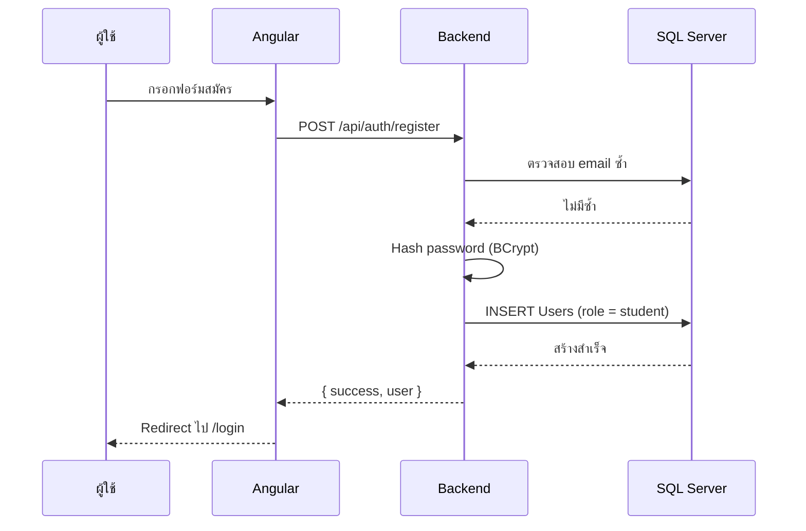
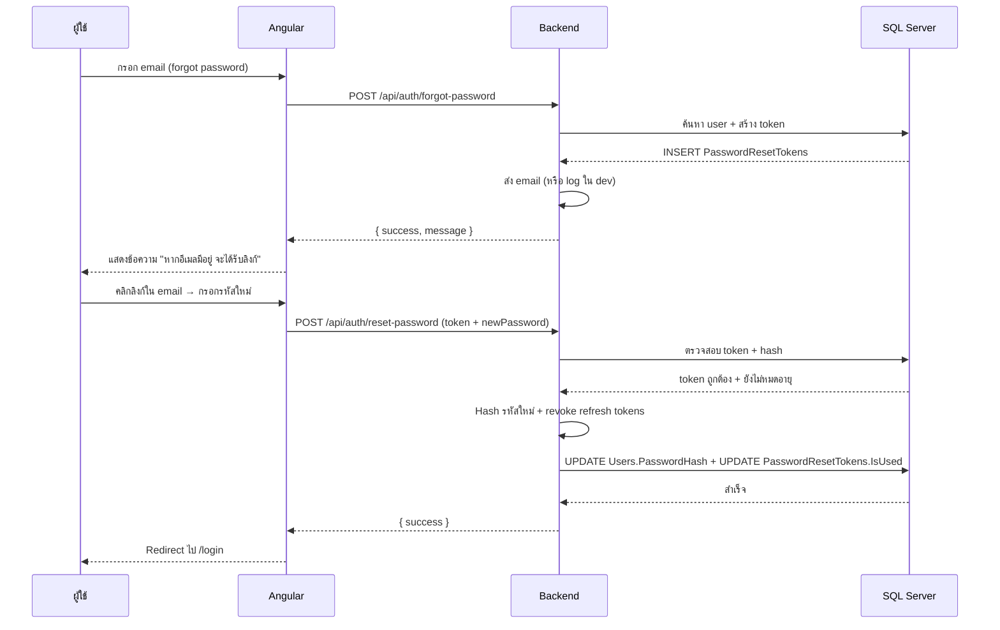

# การตัดสินใจด้านการออกแบบ (Design Decisions)

_มติแก้ไขรอบ Review, การเติมช่องว่าง Auth และการปรับเป็น Modular Architecture_

> ⚠️ **เอกสารอ้างอิงจากช่วงออกแบบ/พัฒนา** — รวมจากไฟล์เดิมหลายไฟล์ เนื้อหาคงไว้ตามต้นฉบับ
> บางส่วนอาจไม่ตรงกับโค้ดปัจจุบัน (เช่น ระบุ .NET 8 แต่ใช้ .NET 10 จริง, โมดูล Messages ถูกลบแล้ว,
> ระบบคำนวณมาสายถูกยกเลิก) — ข้อมูลที่ตรงกับโค้ดล่าสุดดูที่ [architecture.md](../architecture.md), [api-reference.md](../api-reference.md) และ [project-status.md](../project-status.md)

## สารบัญ

1. [มติแก้ไขรอบ Review v2 (ส่วนที่ 4)](#ส่วนที่-1-มติแก้ไขรอบ-review-v2-ส่วนที่-4)
2. [แก้ไขช่องว่าง Auth: Register + Forgot/Reset (ส่วนที่ 7)](#ส่วนที่-2-แก้ไขช่องว่าง-auth-register--forgotreset-ส่วนที่-7)
3. [ปรับโครงสร้างเป็น Modular Architecture (ส่วนที่ 8)](#ส่วนที่-3-ปรับโครงสร้างเป็น-modular-architecture-ส่วนที่-8)

---

## ส่วนที่ 1: มติแก้ไขรอบ Review v2 (ส่วนที่ 4)

> ต้นฉบับ: `docs/internship-log-review-decisions.md` · จัดทำ 14 ส.ค. 2569

### 1. ตารางสรุปมติการแก้ไข

| # | ประเด็นที่ตรวจพบ | มติ | ประเภทการแก้ |
|---|---|---|---|
| 2 | WorkLogs.Hours ระบุว่า "ดึงจาก Attendances" แต่ไม่มี FK | Backend computed — ฝั่ง server เติมค่าเอง, ตัดฟิลด์ Hours ออกจาก DTO ฝั่งรับ (กันปลอมแปลง) | Logic + เอกสาร |
| 3 | AdvisorVisits.PersonNo กำกวม | PersonNo = ลำดับนักศึกษาในกลุ่มนิเทศชุดเดียวกัน, VisitNo = ครั้งที่นิเทศของ internship นั้น + UNIQUE (InternshipID, VisitNo) | นิยาม + Constraint |
| 4 | ไม่มี RefreshToken — JWT 8 ชม. อาจหมดอายุกลางงาน | เพิ่มตาราง RefreshTokens (ตารางที่ 19) + rotation • ปรับอายุเป็น Access 2 ชม. / Refresh 7 วัน • เพิ่ม endpoint refresh/logout | Schema + API + NFR |
| 5 | Tasks ไม่มี FK → Internships (เสี่ยงมอบหมายผิดคน) | แทนที่ InternID ด้วย InternshipID — ผู้รับงานได้จาก Internships.StudentID | Schema |

> ผลรวม: ฐานข้อมูลเพิ่มเป็น **19 ตาราง**

---

### 2. รายละเอียดแต่ละมติ

#### 2.1 [#2] WorkLogs.Hours = Backend Computed
- Frontend **ไม่ส่ง** Hours ใน request — backend เติมจาก Attendances ของ (StudentID + LogDate) ซึ่งเป็น UNIQUE อยู่แล้ว จึงไม่ต้องเพิ่ม FK
- เมื่อคำขอแก้เวลาได้รับอนุมัติ → ให้ sync ค่า Hours ของ WorkLogs วันนั้นใหม่ทั้งหมด

```csharp
// WorkLogsService — ตอนสร้าง/ส่งบันทึก
var att = await db.Attendances.FirstOrDefaultAsync(a => a.StudentID == sid && a.AttDate == log.LogDate);
log.Hours = att?.TotalHours;

// AttendanceService.ReviewEditAsync — หลังอนุมัติแก้เวลา
var logs = await db.WorkLogs.Where(w => w.StudentID == sid && w.LogDate == date).ToListAsync();
logs.ForEach(w => w.Hours = att.TotalHours);
await db.SaveChangesAsync();
```

#### 2.2 [#3] นิยาม PersonNo / VisitNo
- **PersonNo** = ลำดับที่ของนักศึกษาในกลุ่มนิเทศชุดเดียวกัน (อาจารย์คนเดียวกัน + ภาคเรียนเดียวกัน)
- **VisitNo** = ครั้งที่ของการนิเทศสำหรับ internship นั้น
- บังคับ `UNIQUE (InternshipID, VisitNo)` กันบันทึกครั้งที่ซ้ำ

#### 2.3 [#4] Refresh Token (rotation + เก็บ hash)
**Flow ใหม่:**
```
login  → { accessToken (2 ชม.), refreshToken (7 วัน), user }
401    → Angular interceptor เรียก POST /api/auth/refresh → ได้คู่ใหม่
          (token เก่าถูก revoke = rotation) → retry คำขอเดิมอัตโนมัติ
logout → POST /api/auth/logout → revoke token
```
- เก็บเฉพาะ **hash** ของ refreshToken ใน DB (ไม่เก็บตัวดิบ)
- เพิกถอนได้รายเครื่อง/รายครั้ง รองรับ logout ปลอดภัย

#### 2.4 [#5] Tasks ผูก Internship โดยตรง
- ตัด `InternID` ออก → เพิ่ม `InternshipID` (FK → Internships)
- ผู้รับงาน = `Internships.StudentID` (ได้จากการ JOIN) → supervisor มอบหมายข้ามคนไม่ได้
- API ปรับ: POST /api/tasks รับ `internshipId` แทน `internId`

---

### 3. SQL ส่วนที่เปลี่ยน (ใช้แทน/เพิ่มในสคริปต์ส่วนที่ 3)

> ถ้าสร้าง DB ไปแล้วและ Tasks ยังไม่มีข้อมูล: `DROP TABLE Tasks;` ก่อนแล้วสร้างใหม่

```sql
-- ===== Tasks ฉบับแก้แล้ว (แทนฉบับเดิม) =====
CREATE TABLE Tasks (
  TaskID INT IDENTITY(1,1) PRIMARY KEY,
  InternshipID INT NOT NULL REFERENCES Internships(InternshipID),
  AssignedBy INT NOT NULL REFERENCES Users(UserID),
  Title NVARCHAR(200) NOT NULL,
  Detail NVARCHAR(MAX) NULL,
  DueDate DATE NULL,
  Priority NVARCHAR(10) NOT NULL DEFAULT 'medium',
  Status NVARCHAR(20) NOT NULL DEFAULT 'todo',
  CreatedAt DATETIME NOT NULL DEFAULT GETDATE()
);

-- ===== ตารางที่ 19: RefreshTokens (เพิ่มใหม่) =====
CREATE TABLE RefreshTokens (
  RefreshTokenID INT IDENTITY(1,1) PRIMARY KEY,
  UserID INT NOT NULL REFERENCES Users(UserID),
  TokenHash NVARCHAR(255) NOT NULL,
  ExpiresAt DATETIME NOT NULL,
  RevokedAt DATETIME NULL,
  ReplacedByTokenID INT NULL,
  CreatedAt DATETIME NOT NULL DEFAULT GETDATE()
);
CREATE INDEX IX_RefreshTokens_User ON RefreshTokens(UserID);

-- ===== Constraint เพิ่มใน AdvisorVisits =====
ALTER TABLE AdvisorVisits
  ADD CONSTRAINT UQ_Visit_No UNIQUE (InternshipID, VisitNo);
GO
```

**ความสัมพันธ์ที่เพิ่ม:**
```
Users ─< RefreshTokens
Internships ─< Tasks   (แทน Users ─< Tasks เดิมฝั่งผู้รับ)
```

---

### 4. การเปลี่ยนแปลง API

| เปลี่ยนแปลง | รายละเอียด |
|---|---|
| POST /api/auth/login | response เป็น `{ accessToken, refreshToken, user }` |
| POST /api/auth/refresh | เพิ่มใหม่ — รับ refreshToken → ออกคู่ใหม่ + revoke ตัวเก่า |
| POST /api/auth/logout | เพิ่มใหม่ — revoke refreshToken |
| WorkLogs DTO ฝั่งรับ | ตัดฟิลด์ `hours` ออก (backend เติมเอง) |
| POST /api/tasks | รับ `internshipId` แทน `internId` |

---

### 5. อัปเดต NFR (Security)

- เดิม: "JWT หมดอายุ 8 ชม."
- ใหม่: **AccessToken 2 ชม. + RefreshToken 7 วัน (rotation, เพิกถอนได้)**, เก็บ refresh เป็น hash, silent refresh ผ่าน interceptor

---

### 6. เช็กลิสต์ Patch เอกสารส่วนที่ 1–3

**ส่วนที่ 1 (system-docs)**
- [ ] WorkLogs: หมายเหตุ Hours = backend computed, ตัดออกจาก DTO รับ
- [ ] AdvisorVisits: นิยาม PersonNo/VisitNo + unique constraint
- [ ] เพิ่มตาราง RefreshTokens (ตารางที่ 19) + ความสัมพันธ์
- [ ] Tasks: InternshipID แทน InternID
- [ ] เพิ่ม endpoint /api/auth/refresh, /api/auth/logout + response login ใหม่
- [ ] NFR Security อายุ token ฉบับใหม่

**ส่วนที่ 2 (ui-design)**
- [ ] ไม่มีผลต่อโครงสร้าง UI — เพิ่มหมายเหตุ: auth service Angular เก็บ refresh token + interceptor จัดการ 401

**ส่วนที่ 3 (analysis-sql)**
- [ ] แทน CREATE TABLE Tasks ฉบับแก้
- [ ] เพิ่ม CREATE TABLE RefreshTokens + index
- [ ] เพิ่ม ALTER AdvisorVisits (UQ_Visit_No)
- [ ] อัปเดตลำดับ Sequence 3.1 (login คืน refresh token + flow refresh)

---

### 7. ผลต่อฝั่ง Angular (บันทึกไว้ตอนเขียนโค้ด)

- `AuthService.login()` เก็บ `accessToken` + `refreshToken`
- `HttpInterceptor`: แนบ Bearer ทุกคำขอ • เจอ 401 → เรียก refresh ครั้งเดียว (queue คำขอที่ค้าง) → retry
- `logout()` เรียก API revoke แล้วล้าง token ในเครื่อง

---

## ส่วนที่ 2: แก้ไขช่องว่าง Auth: Register + Forgot/Reset (ส่วนที่ 7)

> ต้นฉบับ: `docs/internship-log-auth-gap-fix.md` · จัดทำ 14 ส.ค. 2569

### 1. สรุปปัญหาที่พบ

| # | หน้า UI (ส่วนที่ 6) | Endpoint ที่ขาดใน Backend (ส่วนที่ 1) |
|---|---|---|
| 1 | **S2 Register** — ฟอร์มสมัครสมาชิก | ไม่มี `POST /api/auth/register` (เอกสารเดิมระบุว่า "admin เพิ่มให้" แต่ UI มีหน้า register) |
| 2 | **S3 Forgot Password** — ฟอร์มส่ง email รีเซ็ต | ไม่มี endpoint สำหรับ reset password เลย |

**ผลกระทบ:** หากไม่แก้ → หน้า Register และ Forgot Password ใน Angular จะเรียก API ไม่ได้ → ฟีเจอร์ไม่สมบูรณ์

---

### 2. การแก้ไข Backend (เพิ่ม Endpoints)

#### 2.1 เพิ่มใน `AuthController.cs`

```csharp
// POST /api/auth/register
[HttpPost("register")]
public async Task<IActionResult> Register([FromBody] RegisterRequest req) {
  if (!ModelState.IsValid)
    return BadRequest(new ApiResponse<object>(false, "ข้อมูลไม่ถูกต้อง", null));
  
  // ตรวจสอบว่า email ซ้ำหรือไม่
  if (await _userService.EmailExistsAsync(req.Email))
    return Conflict(new ApiResponse<object>(false, "อีเมลนี้ถูกใช้งานแล้ว", null));
  
  // สร้าง user ใหม่ (role = student โดย default หรือรับจาก req.Role ถ้าเป็น admin)
  var user = await _userService.RegisterAsync(req);
  return Ok(new ApiResponse<object>(true, "สมัครสมาชิกสำเร็จ", user));
}

// POST /api/auth/forgot-password
[HttpPost("forgot-password")]
public async Task<IActionResult> ForgotPassword([FromBody] ForgotPasswordRequest req) {
  // ไม่บอกว่า email มีอยู่จริงหรือไม่ (กัน user enumeration)
  await _userService.SendPasswordResetEmailAsync(req.Email);
  return Ok(new ApiResponse<object>(true, "หากอีเมลมีอยู่ในระบบ จะได้รับลิงก์รีเซ็ตรหัสผ่าน", null));
}

// POST /api/auth/reset-password
[HttpPost("reset-password")]
public async Task<IActionResult> ResetPassword([FromBody] ResetPasswordRequest req) {
  var success = await _userService.ResetPasswordAsync(req.Token, req.NewPassword);
  if (!success)
    return BadRequest(new ApiResponse<object>(false, "ลิงก์ไม่ถูกต้องหรือหมดอายุ", null));
  
  return Ok(new ApiResponse<object>(true, "รีเซ็ตรหัสผ่านสำเร็จ กรุณาล็อกอินใหม่", null));
}
```

#### 2.2 เพิ่ม DTOs ใน `AuthDtos.cs`

```csharp
// Register
public record RegisterRequest(
  [Required][EmailAddress] string Email,
  [Required][MinLength(8)] string Password,
  [Required] string FirstName,
  [Required] string LastName,
  string? StudentID,
  string? Phone,
  string Role = "student"  // default = student, admin สามารถส่ง role อื่นได้
);

// Forgot Password
public record ForgotPasswordRequest(
  [Required][EmailAddress] string Email
);

// Reset Password
public record ResetPasswordRequest(
  [Required] string Token,
  [Required][MinLength(8)] string NewPassword
);
```

#### 2.3 เพิ่ม Methods ใน `AuthService.cs` (หรือแยก UserService)

```csharp
public interface IAuthService {
  // ... methods เดิม ...
  Task<UserDto> RegisterAsync(RegisterRequest req);
  Task<bool> EmailExistsAsync(string email);
  Task SendPasswordResetEmailAsync(string email);
  Task<bool> ResetPasswordAsync(string token, string newPassword);
}

// Implementation (ย่อ)
public async Task<UserDto> RegisterAsync(RegisterRequest req) {
  var role = await _db.Roles.FirstAsync(r => r.RoleName == req.Role);
  var user = new User {
    RoleID = role.RoleID,
    Email = req.Email,
    PasswordHash = BCrypt.Net.BCrypt.HashPassword(req.Password),
    FirstName = req.FirstName,
    LastName = req.LastName,
    StudentID = req.StudentID,
    Phone = req.Phone,
    IsActive = true,
    CreatedAt = DateTime.Now
  };
  _db.Users.Add(user);
  await _db.SaveChangesAsync();
  return ToDto(user);
}

public async Task SendPasswordResetEmailAsync(string email) {
  var user = await _db.Users.FirstOrDefaultAsync(u => u.Email == email);
  if (user == null) return;  // ไม่ throw error (กัน user enumeration)
  
  // สร้าง token (random string)
  var token = Convert.ToBase64String(RandomNumberGenerator.GetBytes(64));
  var tokenHash = BCrypt.Net.BCrypt.HashPassword(token);
  
  var resetToken = new PasswordResetToken {
    UserID = user.UserID,
    TokenHash = tokenHash,
    ExpiresAt = DateTime.UtcNow.AddHours(1),  // หมดอายุใน 1 ชม.
    IsUsed = false,
    CreatedAt = DateTime.Now
  };
  _db.PasswordResetTokens.Add(resetToken);
  await _db.SaveChangesAsync();
  
  // ส่ง email (ในโปรเจกต์นี้จำลองด้วยการ log หรือ return token ใน response สำหรับ dev)
  // TODO: ใช้ EmailService จริงใน production
  Console.WriteLine($"[DEV] Reset link: http://localhost:4200/reset-password?token={token}");
}

public async Task<bool> ResetPasswordAsync(string token, string newPassword) {
  var tokenHash = BCrypt.Net.BCrypt.HashPassword(token);  // hash เพื่อเทียบ
  var resetToken = await _db.PasswordResetTokens
    .FirstOrDefaultAsync(t => t.TokenHash == tokenHash && !t.IsUsed && t.ExpiresAt > DateTime.UtcNow);
  
  if (resetToken == null) return false;
  
  var user = await _db.Users.FindAsync(resetToken.UserID);
  if (user == null) return false;
  
  user.PasswordHash = BCrypt.Net.BCrypt.HashPassword(newPassword);
  resetToken.IsUsed = true;
  
  // Revoke refresh tokens ทั้งหมด (บังคับ login ใหม่)
  var refreshTokens = await _db.RefreshTokens.Where(rt => rt.UserID == user.UserID && rt.RevokedAt == null).ToListAsync();
  refreshTokens.ForEach(rt => rt.RevokedAt = DateTime.UtcNow);
  
  await _db.SaveChangesAsync();
  return true;
}
```

---

### 3. การแก้ไข Database (เพิ่มตาราง)

#### 3.1 เพิ่มตาราง `PasswordResetTokens`

```sql
-- ===== ตารางที่ 20: PasswordResetTokens (เพิ่มใหม่) =====
CREATE TABLE PasswordResetTokens (
  TokenID INT IDENTITY(1,1) PRIMARY KEY,
  UserID INT NOT NULL REFERENCES Users(UserID),
  TokenHash NVARCHAR(255) NOT NULL,
  ExpiresAt DATETIME NOT NULL,
  IsUsed BIT NOT NULL DEFAULT 0,
  CreatedAt DATETIME NOT NULL DEFAULT GETDATE()
);
CREATE INDEX IX_PasswordResetTokens_User ON PasswordResetTokens(UserID);
CREATE INDEX IX_PasswordResetTokens_Hash ON PasswordResetTokens(TokenHash);
GO
```

#### 3.2 อัปเดต Entity ใน `AppDbContext.cs`

```csharp
public DbSet<PasswordResetToken> PasswordResetTokens => Set<PasswordResetToken>();

// ใน OnModelCreating
mb.Entity<PasswordResetToken>(e => {
  e.ToTable("PasswordResetTokens");
  e.HasKey(x => x.TokenID);
  e.HasIndex(x => x.TokenHash);
});
```

#### 3.3 เพิ่ม Model `PasswordResetToken.cs`

```csharp
namespace InternLog.API.Models;
public class PasswordResetToken {
  public int TokenID { get; set; }
  public int UserID { get; set; }
  public string TokenHash { get; set; } = "";
  public DateTime ExpiresAt { get; set; }
  public bool IsUsed { get; set; }
  public DateTime CreatedAt { get; set; }
  public User User { get; set; } = null!;
}
```

---

### 4. เช็กลิสต์การอัปเดตเอกสารเดิม

#### ส่วนที่ 1 (`internship-log-system-docs.md`)
- [ ] เพิ่ม endpoint `POST /api/auth/register` ในตาราง Auth endpoints
- [ ] เพิ่ม endpoint `POST /api/auth/forgot-password` และ `POST /api/auth/reset-password`
- [ ] เพิ่มตาราง `PasswordResetTokens` ใน ERD (ตารางที่ 20)
- [ ] เพิ่มความสัมพันธ์ `Users ─< PasswordResetTokens`

#### ส่วนที่ 3 (`internship-log-analysis-sql.md`)
- [ ] เพิ่ม `CREATE TABLE PasswordResetTokens` ในสคริปต์ SQL
- [ ] เพิ่ม indexes (UserID, TokenHash)

#### ส่วนที่ 4 (`internship-log-review-decisions.md`)
- [ ] บันทึกรายการแก้ไขนี้ (เพิ่มเป็นรายการ #6 และ #7)

#### ส่วนที่ 6 (`internship-log-figma-checklist.md`)
- [ ] ไม่มีผล (UI มีอยู่แล้ว)

---

### 5. Flow การทำงาน (Sequence Diagram)

#### 5.1 Register Flow


#### 5.2 Forgot/Reset Password Flow


---

### 6. Security Considerations

1. **User Enumeration Prevention:** 
   - `forgot-password` ไม่บอกว่า email มีอยู่จริงหรือไม่ (return message เดียวกันเสมอ)
   - `register` บอกเฉพาะกรณี email ซ้ำ (เพราะต้องป้องกัน duplicate)

2. **Token Security:**
   - เก็บเฉพาะ `TokenHash` (BCrypt) ไม่เก็บ token ตรงๆ
   - Token หมดอายุใน 1 ชม.
   - ใช้แล้วลบ (IsUsed = true)
   - Revoke refresh tokens ทั้งหมดเมื่อ reset สำเร็จ

3. **Password Validation:**
   - Minimum 8 chars
   - ต้องมี uppercase + lowercase + number + special char
   - ใช้ BCrypt hash (cost factor 12)

4. **Rate Limiting (แนะนำเพิ่มเติม):**
   - จำกัด `forgot-password` ไม่เกิน 5 ครั้ง/ชั่วโมง/อีเมล (กัน spam)
   - จำกัด `register` ไม่เกิน 10 ครั้ง/ชั่วโมง/IP

---

### 7. Testing (Test Cases)

#### Register
- [ ] TC-01: Register ด้วย email ใหม่ → 200 + สร้าง user สำเร็จ
- [ ] TC-02: Register ด้วย email ที่ซ้ำ → 409 Conflict
- [ ] TC-03: Register ด้วย password อ่อน (ไม่มี special char) → 400 Validation error
- [ ] TC-04: Register โดยไม่ระบุ role → default = student

#### Forgot/Reset Password
- [ ] TC-05: Forgot password ด้วย email ที่มีอยู่ → 200 + ได้ token (ใน dev mode)
- [ ] TC-06: Forgot password ด้วย email ที่ไม่มี → 200 + message เดียวกัน (กัน enumeration)
- [ ] TC-07: Reset password ด้วย token ที่ถูกต้อง → 200 + รหัสเปลี่ยน
- [ ] TC-08: Reset password ด้วย token ที่หมดอายุ → 400
- [ ] TC-09: Reset password ด้วย token ที่ใช้แล้ว → 400
- [ ] TC-10: หลัง reset สำเร็จ → refresh tokens ทั้งหมดถูก revoke → ต้อง login ใหม่

---

### 8. สรุป

✅ แก้ไขช่องว่าง 2 จุดครบถ้วน:
1. เพิ่ม `POST /api/auth/register` → รองรับหน้า S2 Register
2. เพิ่ม `POST /api/auth/forgot-password` + `POST /api/auth/reset-password` + ตาราง `PasswordResetTokens` → รองรับหน้า S3 Forgot Password

**ฐานข้อมูลตอนนี้เป็น 20 ตาราง** (เดิม 19 + PasswordResetTokens)

**ขั้นถัดไป:** รวมการแก้ไขนี้ลงในเอกสารส่วนที่ 1 และส่วนที่ 3 เพื่ออัปเดตเป็นฉบับ v2.1 สมบูรณ์

---

## ส่วนที่ 3: ปรับโครงสร้างเป็น Modular Architecture (ส่วนที่ 8)

> ต้นฉบับ: `docs/internship-log-modular-architecture.md` · จัดทำ 14 ส.ค. 2569

### 1. ทำไมต้องแยกเป็นโมดูล

**โครงสร้างเดิม (Monolithic):** ทุก Controller/Service อยู่ในโฟลเดอร์เดียว → เมื่อระบบขยาย (20+ หน้า, 55+ endpoints) จะดูแลยาก

**โครงสร้างใหม่ (Modular):** แยกตามฟีเจอร์ (Auth, Attendance, Leaves, WorkLogs, …) แต่ละโมดูลมี Controller + Service + DTOs + Models ของตัวเอง

**ข้อดี:**
- ✅ ดูแลง่าย — แก้ฟีเจอร์หนึ่งไม่กระทบฟีเจอร์อื่น
- ✅ ทีมทำงานคู่ขนานได้ —每人รับผิดชอบโมดูลของตัวเอง
- ✅ ทดสอบง่าย — Unit test แยกโมดูล
- ✅ Reusable — โมดูล Auth ใช้ซ้ำในโปรเจกต์อื่นได้
- ✅ Scalable — ถ้าฟีเจอร์ใหญ่ขึ้น แยกเป็น Microservice ได้ในอนาคต

**ข้อเสีย:**
- ⚠️ โครงสร้างโฟลเดอร์ซับซ้อนขึ้นเล็กน้อย
- ️ ต้องจัดการ Dependency ระหว่างโมดูล (เช่น WorkLogs ต้องใช้ Attendances)

---

### 2. โครงสร้าง Backend (ASP.NET Core) — แบบ Modular

#### 2.1 โครงสร้างโฟลเดอร์ใหม่

```
InternLog.API/
├── src/
│   ├── Core/                          ← Shared Core (ใช้ร่วมกันทุกโมดูล)
│   │   ├── Common/
│   │   │   ├── ApiResponse.cs         ← Response กลาง
│   │   │   ├── AppException.cs        ← Custom exception
│   │   │   └── Constants.cs           ← Status constants
│   │   ├── Interfaces/
│   │   │   ├── ICurrentUserService.cs ← ดึง UserId จาก JWT
│   │   │   └── IDateTimeService.cs    ← เวลาปัจจุบัน (สำหรับ test)
│   │   └── Security/
│   │       ├── JwtHelper.cs
│   │       ── PasswordHasher.cs      ← BCrypt wrapper
│   │
│   ├── Infrastructure/                ← Cross-cutting concerns
│   │   ├── Data/
│   │   │   ├── AppDbContext.cs        ← รวมทุก Entity
│   │   │   ├── Configurations/        ← EF Core Fluent API แยกไฟล์
│   │   │   │   ├── UserConfiguration.cs
│   │   │   │   ├── AttendanceConfiguration.cs
│   │   │   │   └── ...
│   │   │   └── Migrations/
│   │   ├── Middleware/
│   │   │   ├── ExceptionMiddleware.cs
│   │   │   └── RequestLoggingMiddleware.cs
│   │   ├── Services/
│   │   │   ├── EmailService.cs        ← ส่ง email (reset password)
│   │   │   └── FileStorageService.cs  ← อัปโหลดไฟล์
│   │   └── Identity/
│   │       ├── JwtAuthentication.cs
│   │       └── RoleAuthorization.cs
│   │
│   └── Modules/                       ←  แยกตามฟีเจอร์
│       ├── Auth/
│       │   ├── AuthController.cs
│       │   ├── AuthService.cs
│       │   ├── IAuthService.cs
│       │   ├── DTOs/
│       │   │   ├── LoginRequest.cs
│       │   │   ├── RegisterRequest.cs
│       │   │   └── ...
│       │   └── Models/
│       │       ├── User.cs
│       │       ├── Role.cs
│       │       └── RefreshToken.cs
│       │
│       ├── Attendance/
│       │   ├── AttendanceController.cs
│       │   ├── AttendanceService.cs
│       │   ├── IAttendanceService.cs
│       │   ├── DTOs/
│       │   └── Models/
│       │       └── Attendance.cs
│       │
│       ├── Leaves/
│       ├── WorkLogs/
│       ├── Tasks/
│       ├── AdvisorVisits/
│       ├── Reports/
│       ├── Messages/
│       ├── Notifications/
│       ├── Evaluations/
│       └── Admin/
│
├── Program.cs                         ← Register ทุกโมดูล
└── appsettings.json
```

#### 2.2 ตัวอย่าง: โมดูล Attendance (ครบชุด)

**Modules/Attendance/Models/Attendance.cs**
```csharp
namespace InternLog.API.Modules.Attendance.Models;

public class Attendance {
  public int AttendanceID { get; set; }
  public int StudentID { get; set; }
  public DateOnly AttDate { get; set; }
  public TimeOnly? CheckInTime { get; set; }
  public TimeOnly? CheckOutTime { get; set; }
  public decimal? TotalHours { get; set; }
  public string Status { get; set; } = "ontime";
  public string? Note { get; set; }
}
```

**Modules/Attendance/DTOs/AttendanceDtos.cs**
```csharp
namespace InternLog.API.Modules.Attendance.DTOs;

public record AttendanceDto(int AttendanceID, DateOnly AttDate, 
  TimeOnly? CheckInTime, TimeOnly? CheckOutTime, decimal? TotalHours, string Status);

public record CheckInResponse(string Status, TimeOnly CheckInTime);
public record AttendanceSummary(int WorkDays, decimal TotalHours, int LateCount);
```

**Modules/Attendance/IAttendanceService.cs**
```csharp
namespace InternLog.API.Modules.Attendance;

public interface IAttendanceService {
  Task<CheckInResponse> CheckInAsync(int studentId);
  Task<AttendanceDto> CheckOutAsync(int studentId);
  Task<List<AttendanceDto>> ListAsync(int studentId, int year, int month);
  Task<AttendanceSummary> SummaryAsync(int studentId, int year, int month);
}
```

**Modules/Attendance/AttendanceService.cs**
```csharp
using InternLog.API.Infrastructure.Data;
using InternLog.API.Modules.Attendance.DTOs;
using Microsoft.EntityFrameworkCore;

namespace InternLog.API.Modules.Attendance;

public class AttendanceService(AppDbContext db) : IAttendanceService {
  public async Task<CheckInResponse> CheckInAsync(int studentId) {
    // ... business logic ...
  }
  // ... methods อื่นๆ ...
}
```

**Modules/Attendance/AttendanceController.cs**
```csharp
using Microsoft.AspNetCore.Authorization;
using Microsoft.AspNetCore.Mvc;
using InternLog.API.Core.Common;
using InternLog.API.Modules.Attendance.DTOs;

namespace InternLog.API.Modules.Attendance;

[ApiController]
[Route("api/attendance")]
[Authorize(Roles = "student")]
public class AttendanceController(IAttendanceService svc) : ControllerBase {
  
  [HttpPost("check-in")]
  public async Task<IActionResult> CheckIn() {
    // ...
  }
}
```

#### 2.3 Program.cs — Register ทุกโมดูล

```csharp
// Core
builder.Services.AddScoped<ICurrentUserService, CurrentUserService>();

// Infrastructure
builder.Services.AddDbContext<AppDbContext>(...);
builder.Services.AddScoped<IEmailService, EmailService>();

// Modules — แยก register ชัดเจน
builder.Services.AddScoped<IAuthService, AuthService>();
builder.Services.AddScoped<IAttendanceService, AttendanceService>();
builder.Services.AddScoped<ILeaveService, LeaveService>();
builder.Services.AddScoped<IWorkLogService, WorkLogService>();
// ... โมดูลอื่นๆ ...
```

---

### 3. โครงสร้าง Frontend (Angular) — แบบ Modular

#### 3.1 โครงสร้างโฟลเดอร์ใหม่

```
src/
├── app/
│   ├── core/                          ← Shared Core (singleton services)
│   │   ├── auth/
│   │   │   ├── auth.service.ts
│   │   │   ├── auth.guard.ts
│   │   │   └── auth.interceptor.ts
│   │   ├── guards/
│   │   │   └── role.guard.ts
│   │   ├── services/
│   │   │   ├── http.service.ts        ← HTTP wrapper
│   │   │   └── notification.service.ts
│   │   └── models/
│   │       ├── user.model.ts
│   │       ── api-response.model.ts
│   │
│   ├── shared/                        ← Reusable components
│   │   ├── components/
│   │   │   ├── button/
│   │   │   ├── input/
│   │   │   ├── status-badge/
│   │   │   └── table/
│   │   ├── pipes/
│   │   │   └── date-format.pipe.ts
│   │   └── directives/
│   │
│   ├── layout/                        ← Shell components
│   │   ├── sidebar/
│   │   ├── topbar/
│   │   └── shell.component.ts
│   │
│   └── features/                      ← ⭐ แยกตามฟีเจอร์ (Lazy Loading)
│       ├── auth/
│       │   ├── login/
│       │   │   ├── login.component.ts
│       │   │   ├── login.component.html
│       │   │   └── login.component.scss
│       │   ├── register/
│       │   ├── forgot-password/
│       │   └── auth.routes.ts
│       │
│       ├── dashboard/
│       │   ├── dashboard-student/
│       │   ├── dashboard-advisor/
│       │   ── dashboard.routes.ts
│       │
│       ├── attendance/
│       │   ├── services/
│       │   │   └── attendance.service.ts
│       │   ├── components/
│       │   │   ├── attendance-page/
│       │   │   └── request-edit-modal/
│       │   ├── models/
│       │   │   └── attendance.model.ts
│       │   └── attendance.routes.ts
│       │
│       ├── leaves/
│       ├── work-logs/
│       ├── tasks/
│       ├── visits/
│       ├── chat/
│       ├── notifications/
│       ├── reports/
│       ├── evaluations/
│       ├── profile/
│       └── admin/
│
├── assets/
├── environments/
└── styles.scss                        ← Global styles + Design System
```

#### 3.2 ตัวอย่าง: โมดูล Attendance (Angular)

**features/attendance/models/attendance.model.ts**
```typescript
export interface Attendance {
  attendanceID: number;
  attDate: string;
  checkInTime?: string;
  checkOutTime?: string;
  totalHours?: number;
  status: 'ontime' | 'late' | 'leave' | 'absent';
}

export interface AttendanceSummary {
  workDays: number;
  totalHours: number;
  lateCount: number;
}
```

**features/attendance/services/attendance.service.ts**
```typescript
import { Injectable, inject } from '@angular/core';
import { HttpClient } from '@angular/common/http';
import { Observable } from 'rxjs';
import { environment } from '@env';
import { Attendance, AttendanceSummary } from '../models/attendance.model';
import { ApiResponse } from '@core/models/api-response.model';

@Injectable({ providedIn: 'root' })
export class AttendanceService {
  private http = inject(HttpClient);
  private baseUrl = `${environment.apiUrl}/api/attendance`;

  checkIn(): Observable<ApiResponse<Attendance>> {
    return this.http.post<ApiResponse<Attendance>>(`${this.baseUrl}/check-in`, {});
  }

  checkOut(): Observable<ApiResponse<Attendance>> {
    return this.http.post<ApiResponse<Attendance>>(`${this.baseUrl}/check-out`, {});
  }

  list(year: number, month: number): Observable<ApiResponse<Attendance[]>> {
    return this.http.get<ApiResponse<Attendance[]>>(
      `${this.baseUrl}?year=${year}&month=${month}`
    );
  }

  summary(year: number, month: number): Observable<ApiResponse<AttendanceSummary>> {
    return this.http.get<ApiResponse<AttendanceSummary>>(
      `${this.baseUrl}/summary?year=${year}&month=${month}`
    );
  }
}
```

**features/attendance/attendance.routes.ts**
```typescript
import { Routes } from '@angular/router';
import { authGuard } from '@core/guards/auth.guard';

export const ATTENDANCE_ROUTES: Routes = [
  {
    path: '',
    loadComponent: () => 
      import('./components/attendance-page/attendance-page.component')
        .then(m => m.AttendancePageComponent),
    canActivate: [authGuard],
    title: 'ลงเวลาปฏิบัติงาน'
  }
];
```

**app.routes.ts — รวมทุกฟีเจอร์**
```typescript
import { Routes } from '@angular/router';

export const routes: Routes = [
  { path: 'login', loadComponent: () => import('@features/auth/login/login.component') },
  { 
    path: 'attendance', 
    loadChildren: () => import('@features/attendance/attendance.routes')
      .then(m => m.ATTENDANCE_ROUTES) 
  },
  { 
    path: 'leaves', 
    loadChildren: () => import('@features/leaves/leaves.routes')
      .then(m => m.LEAVES_ROUTES) 
  },
  // ... ฟีเจอร์อื่นๆ ...
  { path: '**', redirectTo: '/dashboard' }
];
```

---

### 4. โครงสร้าง Database — ยังรวมกัน (Monolithic DB)

**เหตุผล:** โปรเจกต์ขนาดกลาง (20 ตาราง) ไม่จำเป็นต้องแยก Database — ใช้ Schema เดียว แต่แยกตารางตามโมดูลชัดเจน

```
InternLogDB
├── [Auth Module]
│   ├── Roles
│   ├── Users
│   ├── RefreshTokens
│   └── PasswordResetTokens
│
├── [Attendance Module]
│   ── Attendances
│
├── [Leaves Module]
│   ├── LeaveTypes
│   └── Leaves
│
├── [WorkLogs Module]
│   ├── WorkCategories
│   ├── WorkLogs
│   ├── Attachments
│   └── LogComments
│
├── [Tasks Module]
│   └── Tasks
│
├── [AdvisorVisits Module]
│   └── AdvisorVisits
│
├── [Reports Module]
│   └── Reports
│
├── [Messages Module]
│   └── Messages
│
├── [Notifications Module]
│   ── Notifications
│
├── [Evaluations Module]
│   └── Evaluations
│
└── [Admin Module]
    ├── Companies
    └── TrainingPeriods
    └── Internships (เชื่อมโยงทุกโมดูล)
```

**ถ้าอนาคตต้องการแยก Database:**
- แยกเป็น Microservices → แต่ละโมดูลมี DB ของตัวเอง
- ใช้ API Gateway เชื่อมต่อ
- แต่สำหรับโปรเจกต์นี้ **ไม่แนะนำ** (overkill)

---

### 5. Dependency ระหว่างโมดูล

บางโมดูลต้องเรียกใช้กัน → แก้ไขโดยใช้ **Interface + Dependency Injection**

**ตัวอย่าง: WorkLogs ต้องใช้ Attendances**

```csharp
// Modules/WorkLogs/WorkLogService.cs
public class WorkLogService(
  AppDbContext db, 
  IAttendanceService attendanceSvc  // ← Inject interface ของโมดูลอื่น
) : IWorkLogService {
  
  public async Task<WorkLogDto> CreateAsync(CreateWorkLogRequest req, int studentId) {
    // เรียกใช้ AttendanceService จากโมดูล Attendance
    var attendance = await attendanceSvc.GetByDateAsync(studentId, req.LogDate);
    
    var log = new WorkLog {
      // ...
      Hours = attendance?.TotalHours  // ดึงชั่วโมงจาก Attendance
    };
    
    db.WorkLogs.Add(log);
    await db.SaveChangesAsync();
    return ToDto(log);
  }
}
```

**กฎ:** 
- ✅ โมดูลสามารถ Inject Interface ของโมดูลอื่นได้
- ❌ ห้ามเรียก Controller ของโมดูลอื่นโดยตรง
- ❌ ห้ามเข้าถึง Entity ของโมดูลอื่นโดยตรง (ใช้ Service เป็นตัวกลาง)

---

### 6. Migration Plan (จากโครงสร้างเดิม → Modular)

#### ขั้นตอนที่ 1: สร้างโฟลเดอร์ใหม่
```bash
# Backend
mkdir -p src/Core src/Infrastructure src/Modules

# Frontend
mkdir -p src/app/core src/app/shared src/app/features
```

#### ขั้นตอนที่ 2: ย้ายไฟล์ทีละโมดูล
```
Auth → Modules/Auth/
Attendance → Modules/Attendance/
Leaves → Modules/Leaves/
...
```

#### ขั้นตอนที่ 3: อัปเดต namespace
```csharp
// เดิม
namespace InternLog.API.Services;

// ใหม่
namespace InternLog.API.Modules.Attendance;
```

#### ขั้นตอนที่ 4: อัปเดต Program.cs
```csharp
// เพิ่ม using ทุกโมดูล
using InternLog.API.Modules.Auth;
using InternLog.API.Modules.Attendance;
// ...
```

#### ขั้นตอนที่ 5: ทดสอบ
```bash
dotnet build    # Backend
ng build        # Frontend
```

---

### 7. สรุป

| ด้าน | โครงสร้างเดิม | โครงสร้างใหม่ (Modular) |
|---|---|---|
| Backend | Controllers/, Services/ รวมกัน | Modules/{Feature}/ แยกชัดเจน |
| Frontend | components/ รวมกัน | features/{Feature}/ + Lazy Loading |
| Database | รวมกัน (20 ตาราง) | รวมกัน (แยกตามโมดูลในเอกสาร) |
| การดูแล | ยากเมื่อระบบขยาย | ง่าย แยก responsibility ชัด |
| ทีมทำงาน | ชนกันง่าย | คู่ขนานได้每人รับผิดชอบโมดูล |

**แนะนำ:** ใช้โครงสร้าง Modular ตั้งแต่เริ่มโปรเจกต์ → ลด technical debt ในอนาคต

---

### 8. Next Steps

1. ✅ อนุมัติโครงสร้าง Modular นี้
2. 🏗️ สร้างโฟลเดอร์ใหม่ตามโครงสร้างด้านบน
3.  ย้ายโค้ดจากโครงสร้างเดิมเข้าโมดูล
4. 🧪 ทดสอบ build + รันระบบ
5.  อัปเดตเอกสารส่วนที่ 1 (Backend) และส่วนที่ 2 (Frontend) ให้สอดคล้อง
