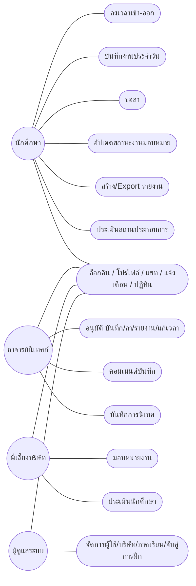
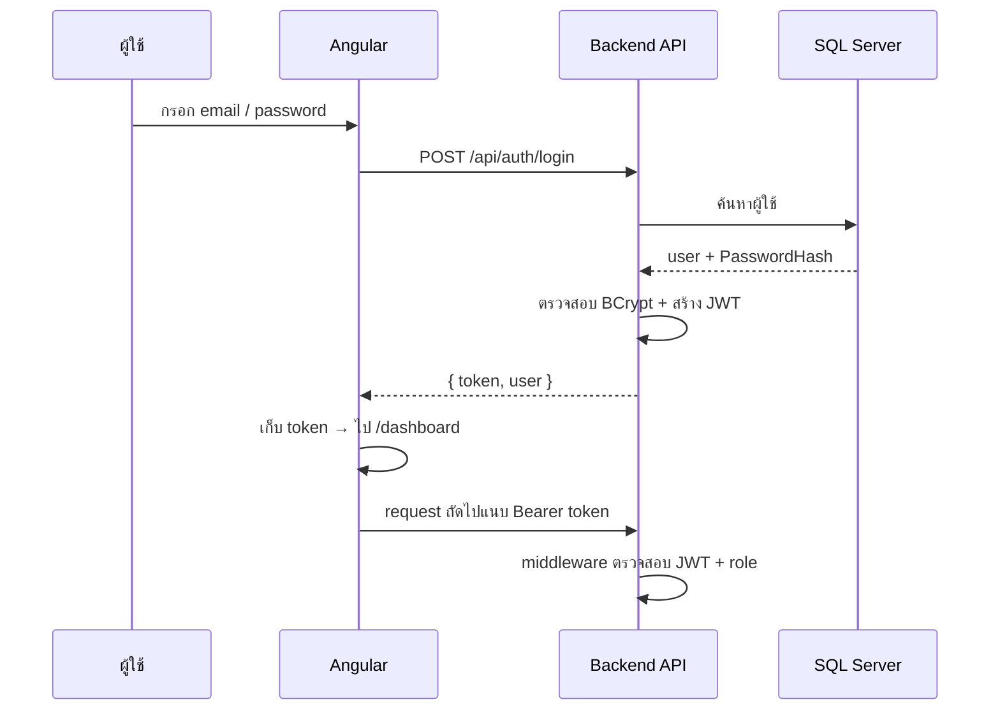
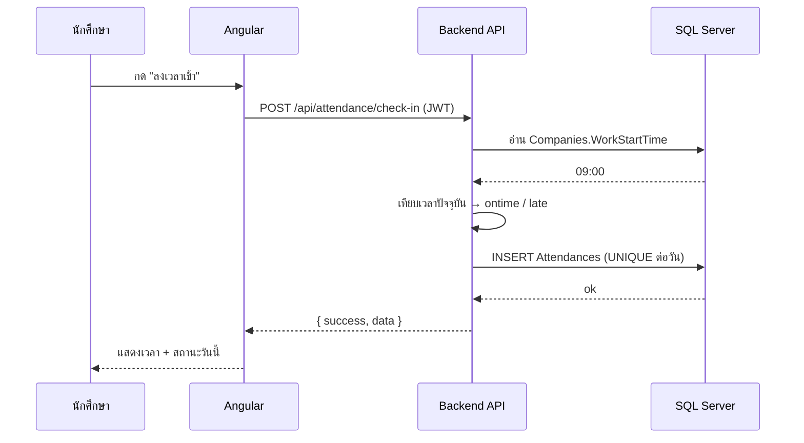
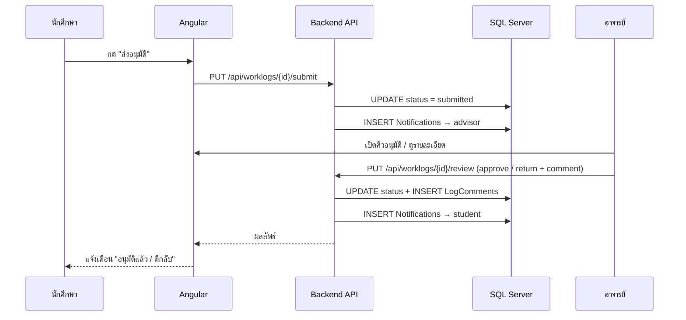

# สเปกระบบ (System Specification)

_ขอบเขตระบบ, Roles & Permissions, ERD, Use Case/SRS, Sequence Diagram และ SQL_

> ⚠️ **เอกสารอ้างอิงจากช่วงออกแบบ/พัฒนา** — รวมจากไฟล์เดิมหลายไฟล์ เนื้อหาคงไว้ตามต้นฉบับ
> บางส่วนอาจไม่ตรงกับโค้ดปัจจุบัน (เช่น ระบุ .NET 8 แต่ใช้ .NET 10 จริง, โมดูล Messages ถูกลบแล้ว,
> ระบบคำนวณมาสายถูกยกเลิก) — ข้อมูลที่ตรงกับโค้ดล่าสุดดูที่ [architecture.md](../architecture.md), [api-reference.md](../api-reference.md) และ [project-status.md](../project-status.md)

## สารบัญ

1. [Final Spec — สเปกฉบับสมบูรณ์ (ส่วนที่ 12)](#ส่วนที่-1-final-spec--สเปกฉบับสมบูรณ์-ส่วนที่-12)
2. [ภาพรวมระบบ + ERD + Backend (ส่วนที่ 1)](#ส่วนที่-2-ภาพรวมระบบ--erd--backend-ส่วนที่-1)
3. [Use Case + SRS + Sequence + SQL (ส่วนที่ 3)](#ส่วนที่-3-use-case--srs--sequence--sql-ส่วนที่-3)

---

## ส่วนที่ 1: Final Spec — สเปกฉบับสมบูรณ์ (ส่วนที่ 12)

> ต้นฉบับ: `docs/internship-log-final-spec.md` · จัดทำ 14 ส.ค. 2569

### 1. สรุปการเปลี่ยนแปลงรอบสุดท้าย (v3)

| # | การเปลี่ยนแปลง | ผลกระทบ |
|---|---|---|
| 1 | ตัด Role **Supervisor (พี่เลี้ยง)** ออก | เหลือ 3 roles: student / advisor / admin |
| 2 | ตัดโมดูล **Chat** ออก | ลบตาราง Messages, ลบหน้าแชท, ลบ API |
| 3 | **WorkLogs = บันทึกจริง** (ตัด flow ขออนุมัติ) | นักศึกษาบันทึกได้ทันที + แก้ไขได้ตลอดเวลา, อาจารย์คอมเมนต์ได้ |
| 4 | **Advisor เพิ่ม/แก้ไขบริษัทของตัวเองได้** | Companies มี FK → Advisor (1 คนดูแลได้หลายบริษัท) |
| 5 | **Reports แยกตาม Role** | Student ดูของตัวเอง / Advisor ดูของ นศ. ที่ดูแล / Admin ดูทั้งระบบ |
| 6 | **Profile แก้ไขได้** + นศ. กรอกที่อยู่+เบอร์โทรบริษัท | เพิ่มฟิลด์ใน Internships |
| 7 | **Admin ดู Dashboard นักศึกษาได้** (Impersonation) | เพิ่ม endpoint + banner |
| 8 | Tasks มอบหมายโดย **Advisor/Admin** (แทน supervisor) | ปรับ AssignedBy |

**มติเสริม (ที่เลือกให้เพื่อให้ระบบสมบูรณ์):**
- WorkLogs: บันทึกทันที + อาจารย์คอมเมนต์ติชมได้ (ไม่มีอนุมัติ/ตีกลับ)
- Evaluations: อาจารย์ประเมินนักศึกษา / นักศึกษาประเมินบริษัท (แทน supervisor)
- Impersonation: Admin ดูได้อย่างเดียว (read-only) + มี Audit Log

---

### 2. Roles & Permission Matrix (3 Roles)

| ความสามารถ | student | advisor | admin |
|---|:---:|:---:|:---:|
| ลงเวลาเข้า-ออก / ขอแก้เวลา | ✅ | — | — |
| อนุมัติคำขอแก้เวลา / วันลา | — | ✅ | 👁 |
| บันทึกงาน (บันทึกจริง + แก้ไขได้ตลอด) | ✅ | — | — |
| คอมเมนต์บันทึกงาน | — | ✅ | 👁 |
| รับงาน / อัปเดตสถานะงาน | ✅ | — | 👁 |
| มอบหมายงาน | — | ✅ | ✅ |
| ดูการนิเทศ | 👁 | ✅ | 👁 |
| บันทึกการนิเทศ | — | ✅ | — |
| เพิ่ม/แก้ไขบริษัท | — | ✅ (ของตัวเอง) | ✅ (ทั้งหมด) |
| จัดการผู้ใช้ / จับคู่การฝึก / ภาคเรียน | — | — | ✅ |
| Impersonate ดู Dashboard นศ. | — | — | ✅ |
| รายงานของตัวเอง | ✅ | — | — |
| รายงานของ นศ. ที่ดูแล | — | ✅ | — |
| รายงานรวมทั้งระบบ | — | — | ✅ |
| ประเมิน (นศ.↔อาจารย์) | ✅ | ✅ | 👁 |

---

### 3. เมนู Sidebar ตาม Role

| เมนู | student | advisor | admin |
|---|:---:|:---:|:---:|
| 🏠 แดชบอร์ด | ✅ | ✅ | ✅ |
| ⏰ ลงเวลา | ✅ | 👁 |  |
| 🏖 วันลา | ✅ | ✅ (อนุมัติ) | 👁 |
| 📅 ปฏิทิน | ✅ | ✅ | ✅ |
| 📝 บันทึกงาน | ✅ | 👁 |  |
| 📋 งานมอบหมาย | ✅ | ✅ | 👁 |
| 🧑 การนิเทศ | 👁 | ✅ | 👁 |
| 📊 รายงาน | ✅ | ✅ | ✅ |
| 🏢 บริษัท | — | ✅ | ✅ |
| 👥 ผู้ใช้ | — | — | ✅ |
| 🔗 จับคู่การฝึก | — | — | ✅ |
| ⚙️ โปรไฟล์ | ✅ | ✅ | ✅ |

*(👁 = ดูได้อย่างเดียว / เมนู Admin เพิ่ม: ภาคเรียน อยู่ใต้หน้าจับคู่การฝึก)*

---

### 4. ERD ฉบับปรับปรุง (19 ตาราง)

**ตัดออก:** Messages (Chat) ❌
**ปรับ Roles:** เหลือ 3 ค่า (student/advisor/admin)

| # | ตาราง | การเปลี่ยนแปลงรอบนี้ |
|---|---|---|
| 1 | Roles | เหลือ 3 roles |
| 2 | Users | เดิม |
| 3 | RefreshTokens | เดิม |
| 4 | PasswordResetTokens | เดิม |
| 5 | Companies | **+ AdvisorID INT NULL FK→Users** (อาจารย์ผู้ดูแล, 1 คนได้หลายบริษัท) |
| 6 | TrainingPeriods | เดิม |
| 7 | Internships | **− SupervisorID** • **+ CompanyAddress NVARCHAR(500) NULL** • **+ CompanyPhone NVARCHAR(20) NULL** (นศ. กรอกใน Profile) |
| 8 | Attendances | เดิม |
| 9 | LeaveTypes | เดิม |
| 10 | Leaves | เดิม (อนุมัติโดย advisor) |
| 11 | WorkCategories | เดิม |
| 12 | WorkLogs | **− Status** (บันทึกจริง ไม่มีอนุมัติ) • คง CreatedAt/UpdatedAt |
| 13 | Attachments | เดิม |
| 14 | LogComments | เดิม (อาจารย์คอมเมนต์) |
| 15 | Tasks | AssignedBy = advisor/admin |
| 16 | AdvisorVisits | เดิม |
| 17 | Reports | เดิม (scope ตาม role) |
| 18 | Notifications | เดิม |
| 19 | Evaluations | EvalType: advisor_eval / student_eval |

**Constraints คงเดิม:** UNIQUE(Email), UNIQUE(StudentID+AttDate), UNIQUE(InternshipID+VisitNo), WorkLogs.Hours = backend computed

---

### 5. ✅ สิ่งที่ต้องทำ — BACKEND (ASP.NET Core 8, Modular)

#### 5.1 Foundation
- [ ] Project setup + EF Core + JWT + BCrypt + Swagger + CORS
- [ ] AppDbContext + Entities 19 ตาราง + Fluent API
- [ ] ExceptionMiddleware + ApiResponse `{success,message,data}`
- [ ] DbSeeder (Roles 3, LeaveTypes, WorkCategories, admin คนแรก)
- [ ] SQL Script 19 ตาราง รันใน SSMS

#### 5.2 Modules + Endpoints ทั้งหมด

**M1 Auth**
- [ ] POST /api/auth/login • register • refresh • logout
- [ ] POST /api/auth/forgot-password • reset-password
- [ ] GET /api/auth/me • PUT /api/auth/change-password

**M2 Profile**
- [ ] PUT /api/profile (ชื่อ, เบอร์โทร, รูป, คณะ/สาขา/ปี)
- [ ] PUT /api/profile/company-contact (นศ.: ที่อยู่+เบอร์โทรบริษัท → Internships.CompanyAddress/Phone)

**M3 Attendance**
- [ ] POST check-in / check-out (ตัดสายอัตโนมัติ)
- [ ] GET list + summary
- [ ] PUT {id}/request-edit (นศ.) • PUT {id}/review (advisor)

**M4 Leaves**
- [ ] GET list + quota • POST create (นศ.)
- [ ] GET pending • PUT {id}/review (advisor)

**M5 WorkLogs (บันทึกจริง)**
- [ ] POST create (บันทึกทันที, Hours auto จาก Attendance)
- [ ] PUT {id} (เจ้าของแก้ไขได้ตลอดเวลา) • DELETE {id}
- [ ] GET list (filters + studentId สำหรับ advisor) • GET {id}
- [ ] POST {id}/attachments • DELETE attachments/{id}
- [ ] GET/POST {id}/comments (อาจารย์คอมเมนต์)

**M6 Tasks**
- [ ] POST create (advisor/admin) • PUT {id} • DELETE {id}
- [ ] PUT {id}/status (นศ.) • GET list (Kanban)

**M7 AdvisorVisits**
- [ ] POST create (advisor) • PUT {id} • GET list

**M8 Reports (แยก Role)**
- [ ] GET /api/reports (scope: นศ.=ตัวเอง / advisor=นศ.ที่ดูแล / admin=ทั้งหมด)
- [ ] POST generate • GET {id}/export-pdf
- [ ] GET /api/reports/stats (สถิติตาม role สำหรับหน้ารายงาน)

**M9 Notifications**
- [ ] GET list • PUT {id}/read • PUT read-all
- [ ] Auto-notify: ลาอนุมัติ/ตีกลับ, ได้งานใหม่, อาจารย์คอมเมนต์, แก้เวลาอนุมัติ

**M10 Evaluations**
- [ ] POST (advisor→นศ. / นศ.→บริษัท) • GET list

**M11 Calendar (Aggregation)**
- [ ] GET /api/calendar?year&month&studentId (สีรายวัน)
- [ ] GET /api/calendar/events?date (SideDrawer)

**M12 Dashboard (แยก Role)**
- [ ] GET /api/dashboard → student / advisor / admin คนละ payload

**M13 Companies**
- [ ] GET (scope: advisor=ของตัวเอง, admin=ทั้งหมด, นศ.=ของตัวเอง)
- [ ] POST create (advisor/admin) • PUT {id} (advisor เฉพาะของตัวเอง)

**M14 Admin**
- [ ] CRUD /api/admin/users + PATCH status + reset-password
- [ ] POST import Excel • GET export
- [ ] POST {id}/impersonate • POST impersonate/stop + Audit Log
- [ ] CRUD /api/admin/periods • CRUD /api/admin/internships

#### 5.3 Business Logic สำคัญ
- [ ] WorkLogs.Hours computed จาก Attendances (sync เมื่อแก้เวลาอนุมัติ)
- [ ] ตัดสายจาก Companies.WorkStartTime
- [ ] เช็กโควตาวันลา
- [ ] Advisor เห็นเฉพาะ นศ./บริษัท ที่ตัวเองดูแล (scope ทุก query)
- [ ] Impersonation token 30 นาที + read-only + Audit Log

---

### 6. ✅ สิ่งที่ต้องทำ — FRONTEND (Angular 17+, Modular)

#### 6.1 Foundation
- [ ] Project + Routing + Guards (authGuard, roleGuard)
- [ ] Auth Interceptor (JWT + refresh + retry)
- [ ] Layout Shell: Topbar + Sidebar (เมนูเปลี่ยนตาม role) + Command Bar + SideDrawer
- [ ] Design System: สี/ฟอนต์/Components กลาง (Button, Input, StatusBadge, Table, Modal)

#### 6.2 หน้าตาม Role

**หน้าร่วม:** Login • Register • Forgot Password • Profile (แก้ไขได้)

**Student (10 หน้า)**
- [ ] Dashboard นศ. (StatCards + ลงเวลาวันนี้ + แจ้งเตือน)
- [ ] ลงเวลา (นาฬิกา + ปุ่ม + ประวัติ + ขอแก้)
- [ ] วันลา (โควตา + ฟอร์ม + ประวัติ)
- [ ] ปฏิทิน (ของตัวเอง + SideDrawer)
- [ ] บันทึกงาน List + Form (บันทึกจริง + แก้ไขได้ + แนบไฟล์ + ดูคอมเมนต์อาจารย์)
- [ ] งานมอบหมาย (Kanban + อัปเดตสถานะ)
- [ ] การนิเทศ (ดู)
- [ ] รายงาน (ของตัวเอง + Export PDF)
- [ ] ประเมินบริษัท
- [ ] Profile (+ กรอกที่อยู่/เบอร์โทรบริษัท)

**Advisor (9 หน้า)**
- [ ] Dashboard อาจารย์ (คิวลา, นศ. ที่ดูแล, บริษัทที่ดูแล)
- [ ] ปฏิทิน (เลือกดู นศ.)
- [ ] บันทึกงาน (ดู + คอมเมนต์)
- [ ] วันลา (อนุมัติ/ไม่อนุมัติ)
- [ ] งานมอบหมาย (มอบหมาย + Kanban)
- [ ] การนิเทศ (บันทึก คนที่/ครั้งที่/วันที่)
- [ ] รายงาน (ของ นศ. ที่ดูแล + เปรียบเทียบ)
- [ ] บริษัท (เพิ่ม/แก้ไขของตัวเอง)
- [ ] ประเมินนักศึกษา

**Admin (7 หน้า)**
- [ ] Dashboard ระบบ (สถิติรวม)
- [ ] จัดการผู้ใช้ (CRUD + Import/Export + Reset รหัส)
- [ ] **ดู Dashboard นศ. (Impersonation + banner)**
- [ ] จัดการบริษัท (ทั้งหมด)
- [ ] จับคู่การฝึก (นศ.–บริษัท–อาจารย์)
- [ ] จัดการภาคเรียน
- [ ] รายงานรวมทั้งระบบ

#### 6.3 UX หลักที่ต้องทำ
- [ ] SideDrawer สำหรับดูรายละเอียด/ฟอร์มด่วน (Teams style)
- [ ] Color coding ปฏิทิน 5 สี
- [ ] Loading/Error/Empty states ทุกหน้า
- [ ] Impersonation banner (สี Warning + ปุ่มกลับ)
- [ ] RBAC UI: ซ่อนปุ่ม/เมนูตาม role

---

### 7. 🧪 Test Cases ที่ต้องปรับ (จากส่วนที่ 10)

- [ ] ตัด Chat tests ออกทั้งหมด
- [ ] ตัด supervisor UAT ออก
- [ ] WorkLogs: เปลี่ยนจาก "ส่งอนุมัติ/อนุมัติ/ตีกลับ" → "บันทึกทันที/แก้ไขได้/อาจารย์คอมเมนต์"
- [ ] เพิ่ม: Advisor เพิ่ม/แก้ไขบริษัท (ของตัวเองเท่านั้น)
- [ ] เพิ่ม: Advisor แก้ไขบริษัทคนอื่น → 403
- [ ] เพิ่ม: Impersonation (admin ดู นศ., read-only, หยุดโหมด)
- [ ] เพิ่ม: Profile นศ. กรอกที่อยู่/เบอร์โทรบริษัท
- [ ] เพิ่ม: Reports แยก scope ตาม role (นศ. ดูของคนอื่นไม่ได้)

---

### 8. 🗺 ลำดับการพัฒนา (Roadmap ปรับใหม่)

```
Phase 0: DB 19 ตาราง + Project setup ทั้ง 2 ฝั่ง
Phase 1: Auth + Profile + Layout Shell (เมนูตาม role)
Phase 2: Attendance + Leaves
Phase 3: WorkLogs (บันทึกจริง) + Tasks
Phase 4: Calendar + Dashboard (3 แบบ)
Phase 5: Visits + Reports (แยก role) + Evaluations
Phase 6: Companies (advisor) + Admin (users/internships/impersonation)
Phase 7: QA ทั้งระบบ + UAT 3 roles
```

---

### 9. สรุปจำนวนงาน

| ฝ่าย | จำนวนงานโดยประมาณ |
|---|---|
| Database | 19 ตาราง + seed + constraints |
| Backend | 14 modules • ~50 endpoints |
| Frontend | ~26 หน้า (รวม auth) • Components กลาง ~15 |
| QA | ~150 test cases (ปรับจาก 170 หลังตัด chat/supervisor) |

**เอกสารนี้คือ "สัญญาการทำงาน" ฉบับสุดท้าย — ทุกการพัฒนาต้องยึดตามนี้**

---

## ส่วนที่ 2: ภาพรวมระบบ + ERD + Backend (ส่วนที่ 1)

> ต้นฉบับ: `docs/internship-log-system-docs.md` · จัดทำ 14 ส.ค. 2569

### 📌 1. ภาพรวมโปรเจกต์

**วัตถุประสงค์:** เว็บแอปพลิเคชันจดบันทึกการฝึกงาน คอนเซปต์คล้าย Microsoft Teams —
นักศึกษาลงเวลา/บันทึกงานประจำวัน/ขอลา, อาจารย์นิเทศก์อนุมัติและบันทึกการนิเทศ,
พี่เลี้ยงมอบหมายงาน, มีรายงานสรุป Export PDF ได้

**ลำดับการทำงาน:**
1. ออกแบบทุกหน้าจอใน **Figma**
2. สร้างฐานข้อมูลใน **SSMS** (SQL Server)
3. พัฒนา **Backend (API)** เชื่อมต่อ DB
4. พัฒนา **Frontend** ด้วย **Angular** เรียกใช้ API

**Tech Stack:**
| Layer | เทคโนโลยี |
|---|---|
| Design | Figma |
| Frontend | Angular |
| Backend | ASP.NET Core Web API (.NET 8) + Entity Framework Core |
| Database | SQL Server (จัดการผ่าน SSMS) |
| Auth | JWT + Role-Based Authorization |
| API Docs | Swagger UI |

---

### 👥 2. ผู้ใช้งาน (User Roles)

| Role | สิทธิ์หลัก |
|---|---|
| 🎓 student (นักศึกษา) | ลงเวลา, บันทึกงาน, ขอลา, ส่งรายงาน, ดูงานมอบหมาย |
| 🧑 advisor (อาจารย์นิเทศก์) | อนุมัติ/ตีกลับ บันทึก-ลา-รายงาน, คอมเมนต์, บันทึกการนิเทศ |
| 💼 supervisor (พี่เลี้ยงบริษัท) | มอบหมายงาน, ประเมินนักศึกษา |
| 🛠 admin | จัดการผู้ใช้ / บริษัท / ภาคเรียน / จับคู่การฝึก |

---

### 🧭 3. โครงสร้าง Layout (สไตล์ MS Teams)

- **Left Sidebar:** แดชบอร์ด • ลงเวลา • วันลา • ปฏิทิน • บันทึกงาน • งานมอบหมาย • การนิเทศ • แชท • รายงาน • โปรไฟล์
- **Top Bar:** ช่องค้นหา (Ctrl+E), กระดิ่งแจ้งเตือน, รูปโปรไฟล์
- **Main Content:** เนื้อหาแต่ละหน้า

**สีสถานะบนปฏิทิน:** 🟢 อนุมัติ | 🟡 รออนุมัติ | 🔴 ไม่ได้บันทึก | 🟣 วันลา | ⚪ วันหยุด

---

### 🗂 4. หน้าเว็บทั้งหมด + สิ่งที่ต้องมี

#### 4.1 Login / Register
- ฟอร์มล็อกอิน, ลืมรหัสผ่าน, สมัครสมาชิก (หรือ admin เพิ่มให้)

#### 4.2 Dashboard
- ความคืบหน้าการฝึก (x/y วัน), ชั่วโมงสะสม, วันลาคงเหลือ
- สถานะวันนี้ + ปุ่มลัด "บันทึกงานวันนี้" / ปุ่มลงเวลา
- แจ้งเตือนล่าสุด, สถานะบันทึกล่าสุด, นัดนิเทศถัดไป
- *เวอร์ชันอาจารย์:* คิวบันทึกรออนุมัติ

#### 4.3 ลงเวลาปฏิบัติงาน (Attendance)
- ปุ่มใหญ่ ลงเวลาเข้า / ลงเวลาออก (บันทึกเวลาปัจจุบันอัตโนมัติ)
- แสดงเวลามา–เวลากลับวันนี้ + รวมชั่วโมง
- ตารางประวัติ: วันที่ | เวลามา | เวลากลับ | รวมชั่วโมง | สถานะ (ตรงเวลา/สาย)
- สรุปประจำเดือน: รวมชั่วโมง, มาสาย, ขาด
- ขอแก้ไขกรณีลืมลงเวลา (ส่งอนุมัติ)

#### 4.4 วันลา (Leave)
- การ์ดโควตา: ลาป่วย/ลากิจ/พักร้อน ใช้ไป–คงเหลือ
- ฟอร์มขอลา: ประเภท, ตั้งแต่–ถึง, จำนวนวัน (อัตโนมัติ), เหตุผล, แนบใบรับรองแพทย์
- รายการคำขอ + สถานะ: รออนุมัติ / อนุมัติ / ไม่อนุมัติ

#### 4.5 ปฏิทิน (Calendar)
- มุมมองเดือน/สัปดาห์, พ.ศ. ไทย
- สีประจำวันที่ตามสถานะ (ตามหัวข้อ 3)
- คลิกวันที่ → เพิ่ม/ดูบันทึกงาน, เพิ่มนัดหมาย

#### 4.6 บันทึกงาน (Work Log)
- รายการ + ฟิลเตอร์ (เดือน/สถานะ/ประเภท) + ค้นหา
- ฟอร์ม: วันที่, เวลาเริ่ม–จบ, ชื่องาน, รายละเอียด, ปัญหา–วิธีแก้, ประเภทงาน, แนบรูป/ไฟล์
- สถานะ: ร่าง / ส่งแล้ว / อนุมัติ / ตีกลับ + คอมเมนต์อาจารย์

#### 4.7 งานมอบหมาย (Tasks)
- Kanban: ยังไม่ทำ / กำลังทำ / เสร็จ
- ผู้มอบหมาย, กำหนดส่ง, ความสำคัญ, ลิงก์ไปบันทึกงาน

#### 4.8 การนิเทศ (Advisor Visits)
- ตาราง: คนที่ | ครั้งที่ | วันที่ | ชื่ออาจารย์นิเทศ | รูปแบบ (Onsite/Online) | สรุปผล | คะแนน

#### 4.9 แชท / แจ้งเตือน
- แชท 1:1 นักศึกษา ↔ อาจารย์ ↔ พี่เลี้ยง
- แจ้งเตือนระบบ: อนุมัติ/ตีกลับ, งานใหม่, ใกล้ครบกำหนดส่ง

#### 4.10 รายงาน (Reports)
- สรุปรายสัปดาห์/เดือน อัตโนมัติจากบันทึก + ลงเวลา + วันลา
- กราฟชั่วโมงตามประเภทงาน
- ตารางการนิเทศ, Export PDF, อาจารย์อนุมัติรายฉบับ

#### 4.11 ประเมิน (Evaluation)
- พี่เลี้ยงประเมินนักศึกษา / นักศึกษาประเมินสถานประกอบการ

#### 4.12 โปรไฟล์ / ตั้งค่า
- ข้อมูลส่วนตัว, รหัสนศ., บริษัท, ช่วงฝึก, อาจารย์ที่ปรึกษา, เปลี่ยนรหัสผ่าน

#### 4.13 Admin Panel
- จัดการผู้ใช้ (import รายชื่อ), บริษัท, ภาคเรียน, จับคู่ นศ.–บริษัท–อาจารย์

---

### 🔁 5. Status Flow

```
บันทึกงาน:  draft → submitted → approved
                              → returned → (แก้) → submitted
วันลา:      pending → approved / rejected
รายงาน:     draft → submitted → approved / returned
ลงเวลาแก้:  pending_edit → approved / rejected
```

---

### 🗄 6. ERD เต็มรูปแบบ (18 ตาราง)

#### 6.1 Roles
| Field | Type | หมายเหตุ |
|---|---|---|
| RoleID | INT | PK |
| RoleName | NVARCHAR(50) | student / advisor / supervisor / admin |

#### 6.2 Users
| Field | Type | หมายเหตุ |
|---|---|---|
| UserID | INT | PK |
| RoleID | INT | FK → Roles |
| Email | NVARCHAR(100) | UNIQUE (ใช้ล็อกอิน) |
| PasswordHash | NVARCHAR(255) | BCrypt |
| FirstName | NVARCHAR(100) | |
| LastName | NVARCHAR(100) | |
| StudentID | NVARCHAR(20) | NULL |
| Phone | NVARCHAR(20) | |
| IsActive | BIT | default 1 |
| CreatedAt | DATETIME | default GETDATE() |

#### 6.3 Companies
| Field | Type | หมายเหตุ |
|---|---|---|
| CompanyID | INT | PK |
| Name | NVARCHAR(200) | |
| Address | NVARCHAR(500) | |
| Phone | NVARCHAR(20) | |
| WorkStartTime | TIME | default 09:00 (เกณฑ์ "สาย") |
| WorkEndTime | TIME | default 18:00 |

#### 6.4 TrainingPeriods
| Field | Type | หมายเหตุ |
|---|---|---|
| PeriodID | INT | PK |
| PeriodName | NVARCHAR(100) | เช่น ภาคเรียนที่ 1/2569 |
| StartDate | DATE | |
| EndDate | DATE | |
| IsActive | BIT | |

#### 6.5 Internships ⭐ (ตารางแกนกลาง)
| Field | Type | หมายเหตุ |
|---|---|---|
| InternshipID | INT | PK |
| StudentID | INT | FK → Users |
| CompanyID | INT | FK → Companies |
| AdvisorID | INT | FK → Users (อาจารย์นิเทศก์) |
| SupervisorID | INT | FK → Users NULL (พี่เลี้ยง) |
| PeriodID | INT | FK → TrainingPeriods |
| StartDate | DATE | |
| EndDate | DATE | |
| RequiredDays | INT | เช่น 60 |
| RequiredHours | INT | เช่น 480 |
| Status | NVARCHAR(20) | active / completed |

#### 6.6 Attendances
| Field | Type | หมายเหตุ |
|---|---|---|
| AttendanceID | INT | PK |
| StudentID | INT | FK → Users |
| AttDate | DATE | UNIQUE (StudentID, AttDate) |
| CheckInTime | TIME | NULL |
| CheckOutTime | TIME | NULL |
| TotalHours | DECIMAL(5,2) | คำนวณอัตโนมัติ |
| Status | NVARCHAR(20) | ontime / late / leave / absent / pending_edit |
| Note | NVARCHAR(500) | เหตุผลขอแก้เวลา |

#### 6.7 LeaveTypes
| Field | Type | หมายเหตุ |
|---|---|---|
| LeaveTypeID | INT | PK |
| TypeName | NVARCHAR(50) | ลาป่วย / ลากิจ / ลาพักร้อน |
| MaxDays | INT | โควตาสูงสุด |

#### 6.8 Leaves
| Field | Type | หมายเหตุ |
|---|---|---|
| LeaveID | INT | PK |
| StudentID | INT | FK → Users |
| LeaveTypeID | INT | FK → LeaveTypes |
| StartDate | DATE | |
| EndDate | DATE | |
| TotalDays | DECIMAL(4,1) | รองรับครึ่งวัน |
| Reason | NVARCHAR(500) | |
| AttachmentPath | NVARCHAR(255) | NULL (ใบรับรองแพทย์) |
| Status | NVARCHAR(20) | pending / approved / rejected |
| ApprovedBy | INT | FK → Users NULL |
| ApprovedAt | DATETIME | NULL |
| CreatedAt | DATETIME | |

#### 6.9 WorkCategories
| Field | Type | หมายเหตุ |
|---|---|---|
| CategoryID | INT | PK |
| CategoryName | NVARCHAR(100) | Development / Meeting / Doc / Testing / อื่น ๆ |

#### 6.10 WorkLogs
| Field | Type | หมายเหตุ |
|---|---|---|
| LogID | INT | PK |
| StudentID | INT | FK → Users |
| LogDate | DATE | |
| Title | NVARCHAR(200) | |
| Description | NVARCHAR(MAX) | |
| Problem | NVARCHAR(MAX) | NULL |
| Solution | NVARCHAR(MAX) | NULL |
| CategoryID | INT | FK → WorkCategories |
| Hours | DECIMAL(5,2) | ดึงจาก Attendances |
| Status | NVARCHAR(20) | draft / submitted / approved / returned |
| CreatedAt | DATETIME | |
| UpdatedAt | DATETIME | NULL |

#### 6.11 Attachments
| Field | Type | หมายเหตุ |
|---|---|---|
| AttachmentID | INT | PK |
| LogID | INT | FK → WorkLogs |
| FileName | NVARCHAR(255) | |
| FilePath | NVARCHAR(500) | |
| FileType | NVARCHAR(20) | |
| FileSize | BIGINT | |
| UploadedAt | DATETIME | |

#### 6.12 LogComments
| Field | Type | หมายเหตุ |
|---|---|---|
| CommentID | INT | PK |
| LogID | INT | FK → WorkLogs |
| UserID | INT | FK → Users (ผู้คอมเมนต์) |
| Message | NVARCHAR(MAX) | |
| CreatedAt | DATETIME | |

#### 6.13 Tasks
| Field | Type | หมายเหตุ |
|---|---|---|
| TaskID | INT | PK |
| InternID | INT | FK → Users (ผู้รับงาน) |
| AssignedBy | INT | FK → Users (ผู้มอบหมาย) |
| Title | NVARCHAR(200) | |
| Detail | NVARCHAR(MAX) | NULL |
| DueDate | DATE | NULL |
| Priority | NVARCHAR(10) | low / medium / high |
| Status | NVARCHAR(20) | todo / doing / done |
| CreatedAt | DATETIME | |

#### 6.14 AdvisorVisits
| Field | Type | หมายเหตุ |
|---|---|---|
| VisitID | INT | PK |
| InternshipID | INT | FK → Internships |
| PersonNo | INT | คนที่ |
| VisitNo | INT | ครั้งที่ |
| VisitDate | DATE | วันที่ |
| AdvisorID | INT | FK → Users (ชื่ออาจารย์ได้จากการ JOIN) |
| Method | NVARCHAR(20) | onsite / online |
| Summary | NVARCHAR(MAX) | ผลการนิเทศ |
| Score | DECIMAL(5,2) | NULL |
| CreatedAt | DATETIME | |

#### 6.15 Messages
| Field | Type | หมายเหตุ |
|---|---|---|
| MessageID | INT | PK |
| SenderID | INT | FK → Users |
| ReceiverID | INT | FK → Users |
| Content | NVARCHAR(MAX) | |
| IsRead | BIT | default 0 |
| SentAt | DATETIME | |

#### 6.16 Notifications
| Field | Type | หมายเหตุ |
|---|---|---|
| NotificationID | INT | PK |
| UserID | INT | FK → Users (ผู้รับ) |
| Message | NVARCHAR(500) | |
| RelatedType | NVARCHAR(50) | NULL: worklog / leave / task / report |
| RelatedID | INT | NULL |
| IsRead | BIT | default 0 |
| CreatedAt | DATETIME | |

#### 6.17 Reports
| Field | Type | หมายเหตุ |
|---|---|---|
| ReportID | INT | PK |
| StudentID | INT | FK → Users |
| ReportType | NVARCHAR(20) | weekly / monthly |
| StartDate | DATE | |
| EndDate | DATE | |
| Summary | NVARCHAR(MAX) | NULL |
| Status | NVARCHAR(20) | draft / submitted / approved / returned |
| ApprovedBy | INT | FK → Users NULL |
| CreatedAt | DATETIME | |

#### 6.18 Evaluations
| Field | Type | หมายเหตุ |
|---|---|---|
| EvaluationID | INT | PK |
| InternshipID | INT | FK → Internships |
| EvaluatorID | INT | FK → Users |
| EvalType | NVARCHAR(50) | supervisor_eval / student_eval |
| TotalScore | DECIMAL(5,2) | |
| Comment | NVARCHAR(MAX) | NULL |
| EvaluatedAt | DATETIME | |

#### 6.19 ความสัมพันธ์ (1 → N)
```
Roles ─< Users
Users ─< Internships >─ Companies , TrainingPeriods
Internships ─< AdvisorVisits , Evaluations
Users ─< Attendances , Leaves >─ LeaveTypes
Users ─< WorkLogs >─ WorkCategories
WorkLogs ─< Attachments , LogComments
Users ─< Tasks (ผู้รับ & ผู้มอบหมาย)
Users ─< Messages (ผู้ส่ง & ผู้รับ) , Notifications , Reports
```

#### 6.20 Constraints สำคัญ
- UNIQUE (Email) ใน Users
- UNIQUE (StudentID, AttDate) ใน Attendances — 1 วันลงเวลาได้ครั้งเดียว
- Default: IsActive=1, IsRead=0, CreatedAt=GETDATE()
- FK ทุกตัวตามรายการความสัมพันธ์

---

### 🛠 7. ออกแบบหลังบ้าน (Backend)

#### 7.1 สถาปัตยกรรม (Layered)
```
Angular ──HTTP+JWT──▶ [Controller] ─▶ [Service] ─▶ [EF Core DbContext] ─▶ SQL Server
                        validate        business logic    18 Entities
                        response กลาง   แจ้งเตือนอัตโนมัติ
```
- **Controller:** รับ request / validate / คืน response
- **Service:** กฎธุรกิจทั้งหมด
- **Data:** DbContext + Entities ตาม ERD
- **Middleware:** JWT Auth, Exception กลาง, CORS (ยอม localhost:4200)

#### 7.2 โครงสร้างโฟลเดอร์
```
InternLog.API/
├── Controllers/   (Auth, Attendance, Leaves, WorkLogs, Tasks,
│                   AdvisorVisits, Reports, Messages, Notifications,
│                   Evaluations, Admin, Dashboard)
├── Services/
├── Data/          (AppDbContext.cs)
├── Models/        (Entities 18 ตาราง)
├── DTOs/
├── Middleware/    (ExceptionMiddleware.cs)
├── Utils/         (JwtHelper, FileHelper)
└── appsettings.json
```

#### 7.3 ตารางสิทธิ์
| ความสามารถ | student | advisor | supervisor | admin |
|---|---|---|---|---|
| ลงเวลา/บันทึกงาน/ขอลา | ✅ | 👁 | 👁 | — |
| อนุมัติบันทึก/ลา/รายงาน | — | ✅ | — | — |
| มอบหมายงาน | — | ✅ | ✅ | — |
| บันทึกการนิเทศ | 👁 | ✅ | — | — |
| ประเมิน | 👁 | — | ✅ | — |
| จัดการผู้ใช้/บริษัท/ภาคเรียน | — | — | — | ✅ |

**JWT Claims:** `sub=userId, role, name, exp=8ชม.`

#### 7.4 API Endpoints
**Auth**
| POST | /api/auth/login | ล็อกอิน → JWT | ทุก role |
| GET | /api/auth/me | ข้อมูลผู้ใช้ปัจจุบัน | ทุก role |
| PUT | /api/auth/change-password | เปลี่ยนรหัส | ทุก role |

**Dashboard / Calendar**
| GET | /api/dashboard | หน้าแรกตาม role | ทุก role |
| GET | /api/calendar?month= | สถานะรายวันสำหรับสีปฏิทิน | student, advisor |

**Attendance**
| POST | /api/attendance/check-in , check-out | ลงเวลา | student |
| GET | /api/attendance?month= | ประวัติ | student, advisor |
| GET | /api/attendance/summary | สรุปชั่วโมง/สาย/ขาด | student |
| PUT | /api/attendance/{id}/request-edit | ขอแก้เวลา | student |
| PUT | /api/attendance/{id}/review | อนุมัติคำขอแก้ | advisor, supervisor |

**Leaves**
| GET | /api/leaves , /api/leaves/quota | ประวัติ , โควตาคงเหลือ | student |
| POST | /api/leaves | ยื่นลา (+ไฟล์) | student |
| GET | /api/leaves/pending | คิวอนุมัติ | advisor |
| PUT | /api/leaves/{id}/review | อนุมัติ/ไม่อนุมัติ | advisor |

**WorkLogs**
| GET | /api/worklogs , /{id} , /pending | รายการ , รายละเอียด , คิวอนุมัติ | student/advisor |
| POST | /api/worklogs | สร้าง (draft/submit) | student |
| PUT | /api/worklogs/{id} , /submit , /review | แก้ไข , ส่งอนุมัติ , อนุมัติ/ตีกลับ | ตามสิทธิ์ |
| POST | /api/worklogs/{id}/attachments , /comments | แนบไฟล์ , คอมเมนต์ | ตามสิทธิ์ |
| DELETE | /api/attachments/{id} | ลบไฟล์ | เจ้าของ |

**Tasks**
| GET | /api/tasks | รายการ | student, supervisor, advisor |
| POST | /api/tasks | มอบหมายงาน | supervisor, advisor |
| PUT | /api/tasks/{id} , /{id}/status | แก้ไข , อัปเดตสถานะ | ผู้มอบหมาย / student |
| DELETE | /api/tasks/{id} | ลบ | ผู้มอบหมาย |

**AdvisorVisits**
| GET | /api/visits?internshipId= | รายการ | student, advisor |
| POST | /api/visits | บันทึก คนที่/ครั้งที่/วันที่/อาจารย์ | advisor |
| PUT | /api/visits/{id} | แก้ไข | advisor |

**Reports**
| GET | /api/reports | รายการ | student, advisor |
| POST | /api/reports/generate | สร้างจาก logs ในช่วงวันที่ | student |
| PUT | /api/reports/{id}/submit , /review | ส่ง , อนุมัติ/ตีกลับ | ตามสิทธิ์ |
| GET | /api/reports/{id}/export-pdf | Export PDF | student, advisor |

**Messages / Notifications**
| GET | /api/messages/{userId} | บทสนทนา | ทุก role |
| POST | /api/messages | ส่งข้อความ | ทุก role |
| GET | /api/notifications | รายการแจ้งเตือน | ทุก role |
| PUT | /api/notifications/{id}/read | อ่านแล้ว | ทุก role |

**Evaluations**
| GET | /api/evaluations?internshipId= | ดูผลประเมิน | ผู้เกี่ยวข้อง |
| POST | /api/evaluations | ส่งประเมิน | supervisor, student |

**Admin** (admin เท่านั้น)
| CRUD | /api/admin/users | จัดการผู้ใช้ |
| CRUD | /api/admin/companies | จัดการบริษัท |
| CRUD | /api/admin/periods | จัดการภาคเรียน |
| POST | /api/admin/internships | จับคู่ นศ.–บริษัท–อาจารย์ |

#### 7.5 Business Logic (Service Layer)
1. **CalcHours** — TotalHours = check-out − check-in
2. **DetectLate** — check-in > Companies.WorkStartTime = สาย
3. **CheckLeaveQuota** — ผลรวมวันลา (อนุมัติ+รอ) ≤ LeaveTypes.MaxDays
4. **GenReport** — รวม WorkLogs + Attendance + Leaves ในช่วงวันที่
5. **BuildCalendar** — merge รายวัน → status สีต่อวัน
6. **AutoNotify** — สร้าง Notification ทุกครั้งที่สถานะเปลี่ยน
7. **OwnershipCheck** — แก้ได้เฉพาะของตนเอง / อนุมัติได้เฉพาะ นศ. ที่ดูแล

#### 7.6 รูปแบบ Response กลาง
```json
{ "success": true,  "message": "บันทึกสำเร็จ",   "data": { } }
{ "success": false, "message": "สิทธิ์ไม่เพียงพอ", "errors": [] }
```

#### 7.7 การเชื่อมต่อ DB + Seed Data
- Connection String: `Server=.;Database=InternLogDB;Trusted_Connection=True;TrustServerCertificate=True;`
- Workflow: รัน CREATE TABLE ใน SSMS → `dotnet ef dbcontext scaffold` (DB First)
- Seed: Roles (4 แถว), LeaveTypes (ป่วย 30 / กิจ 3 / พักร้อน 6), WorkCategories (5 หมวด)

---

### 🎨 8. รายการหน้าจอใน Figma (~20 screens)

1. Login  2. Register/ลืมรหัส  3. Dashboard (นศ.)  4. Dashboard (อาจารย์)
5. ลงเวลา  6. วันลา + ฟอร์มขอลา  7. ปฏิทินเดือน  8. Popup บันทึกงาน
9. Work Log List  10. Work Log Form  11. Tasks  12. การนิเทศ + ฟอร์ม
13. Chat  14. Notifications  15. Reports  16. Preview PDF
17. Evaluation  18. Profile  19. Admin Users  20. Admin Internships

---

### 🗺 9. แผนการพัฒนา (Roadmap)

1. ✅ วางโครงสร้าง + ERD + Backend (เอกสารนี้)
2. 🧾 สร้าง DB: รัน CREATE TABLE 18 ตาราง + Seed ใน SSMS
3. 💻 ตั้งโปรเจกต์ API + Auth (JWT) + Swagger
4. 🔌 พัฒนา API ทีละโมดูล: Attendance → Leaves → WorkLogs → Tasks → Visits → Reports → Chat/Notify → Admin
5. 🎨 ออกแบบ Figma ครบ 20 screens
6. 🅰️ พัฒนา Angular ตาม Figma + เรียก API
7. 🧪 เทสทั้งระบบ + Export PDF + ส่งมอบ

---

## ส่วนที่ 3: Use Case + SRS + Sequence + SQL (ส่วนที่ 3)

> ต้นฉบับ: `docs/internship-log-analysis-sql.md` · จัดทำ 14 ส.ค. 2569

### 1. Use Case Diagram



#### Use Case Description (ย่อ)

| UC | ชื่อ | Actor | Include / Extend |
|---|---|---|---|
| 01 | ล็อกอิน | ทุกคน | include สร้าง JWT • extend ลืมรหัสผ่าน |
| 02 | ลงเวลาเข้า-ออก | student | include คำนวณ ชม.+ตัดสาย • extend ขอแก้เวลา |
| 03 | บันทึกงานประจำวัน | student | include แนบไฟล์ |
| 04 | ส่งบันทึกอนุมัติ | student | include แจ้งเตือนอาจารย์ |
| 05 | อนุมัติ/ตีกลับ | advisor | ใช้กับ บันทึก/ลา/รายงาน/แก้เวลา • include แจ้งเตือน นศ. |
| 06 | ขอลา | student | include เช็กโควตา • extend แนบใบรับรองแพทย์ |
| 07 | งานมอบหมาย | supervisor, advisor / student | กระดาน Kanban |
| 08 | บันทึกการนิเทศ | advisor | คนที่/ครั้งที่/วันที่/คะแนน |
| 09 | รายงาน | student | include รวมข้อมูลอัตโนมัติ • extend Export PDF |
| 10 | แชท/แจ้งเตือน | ทุกคน | |
| 11 | ประเมิน 2 ทาง | supervisor ↔ student | |
| 12 | จัดการระบบ | admin | |
| 13 | ปฏิทิน/แดชบอร์ด | student, advisor | รวมสถานะรายวัน |

---

### 2. SRS ฉบับกระชับ

#### 2.1 Functional Requirements (FR)
| ID | ข้อกำหนด |
|---|---|
| FR-01 | ล็อกอิน/JWT/เปลี่ยนรหัส/จัดการโปรไฟล์ |
| FR-02 | ลงเวลาเข้า-ออก, คำนวณชั่วโมงอัตโนมัติ, ตัดสถานะสาย, ขอแก้เวลา |
| FR-03 | ขอลา + เช็กโควตา + อนุมัติ/ไม่อนุมัติ |
| FR-04 | บันทึกงาน CRUD + สถานะ draft→submitted→approved/returned + แนบไฟล์ + คอมเมนต์ |
| FR-05 | มอบหมายงาน + Kanban |
| FR-06 | บันทึกการนิเทศ (คนที่/ครั้งที่/วันที่/อาจารย์/คะแนน) |
| FR-07 | รายงานอัตโนมัติรายสัปดาห์/เดือน + อนุมัติ + Export PDF |
| FR-08 | แชท 1:1 + แจ้งเตือนอัตโนมัติ |
| FR-09 | ประเมิน 2 ทาง |
| FR-10 | Admin: ผู้ใช้/บริษัท/ภาคเรียน/จับคู่การฝึก |
| FR-11 | แดชบอร์ด + ปฏิทินสีสถานะ แยกตาม role |

#### 2.2 Non-Functional Requirements (NFR)
| ด้าน | ข้อกำหนด |
|---|---|
| Performance | หน้าหลักโหลด < 3 วินาที, รองรับผู้ใช้พร้อมกัน ≥ 200 |
| Security | BCrypt, JWT หมดอายุ 8 ชม., RBAC, HTTPS, จำกัดชนิด/ขนาดไฟล์อัปโหลด |
| Usability | ไทยทั้งระบบ, desktop-first (≥1024px), flow หลักไม่เกิน 3 คลิก |
| Reliability | Backup DB อัตโนมัติรายวัน, กู้คืนได้ภายใน 1 ชม. |
| Availability | ≥ 99% ในช่วงเวลาทำการ |
| Maintainability | Layered architecture, Swagger docs, coding standards ทีม |
| Compatibility | Chrome/Edge/Firefox เวอร์ชันล่าสุด, SQL Server 2019+ |

#### 2.3 PDPA และความเป็นส่วนตัว
- Consent checkbox ตอนสมัคร/ล็อกอินครั้งแรก + หน้า Privacy Policy
- ข้อมูลเข้าถึงได้เฉพาะผู้เกี่ยวข้องตาม RBAC
- ลบ/ทำลายข้อมูลเมื่อร้องขอ หรือครบกำหนดอายุการเก็บ

#### 2.4 ข้อจำกัด (Constraints)
- ต้องใช้ Angular (frontend) + SQL Server ผ่าน SSMS (ตามข้อกำหนดรายวิชา)
- Backend เลือก ASP.NET Core Web API + EF Core
- ทีมพัฒนาต้องทำตาม coding standards และ Git workflow ที่กำหนด

---

### 3. Sequence Diagram 3 Flow หลัก

#### 3.1 ล็อกอิน / JWT


#### 3.2 ลงเวลา (ตัดสายอัตโนมัติ)


#### 3.3 ส่งบันทึก → อาจารย์อนุมัติ


---

### 4. สคริปต์ฐานข้อมูล (รันใน SSMS)

> วิธีใช้: เปิด SSMS → New Query → วางสคริปต์ทั้งชุด → Execute
> ผลลัพธ์: เกิดฐานข้อมูล `InternLogDB` พร้อม 18 ตาราง + Index + Seed data

```sql
-- =============================================
-- InternLogDB : ระบบจดบันทึกการฝึกงาน (18 ตาราง)
-- =============================================
IF DB_ID('InternLogDB') IS NULL CREATE DATABASE InternLogDB;
GO
USE InternLogDB;
GO

CREATE TABLE Roles (
  RoleID INT IDENTITY(1,1) PRIMARY KEY,
  RoleName NVARCHAR(50) NOT NULL
);

CREATE TABLE Users (
  UserID INT IDENTITY(1,1) PRIMARY KEY,
  RoleID INT NOT NULL REFERENCES Roles(RoleID),
  Email NVARCHAR(100) NOT NULL UNIQUE,
  PasswordHash NVARCHAR(255) NOT NULL,
  FirstName NVARCHAR(100) NOT NULL,
  LastName NVARCHAR(100) NOT NULL,
  StudentID NVARCHAR(20) NULL,
  Phone NVARCHAR(20) NULL,
  IsActive BIT NOT NULL DEFAULT 1,
  CreatedAt DATETIME NOT NULL DEFAULT GETDATE()
);

CREATE TABLE Companies (
  CompanyID INT IDENTITY(1,1) PRIMARY KEY,
  Name NVARCHAR(200) NOT NULL,
  Address NVARCHAR(500) NULL,
  Phone NVARCHAR(20) NULL,
  WorkStartTime TIME NOT NULL DEFAULT '09:00',
  WorkEndTime TIME NOT NULL DEFAULT '18:00'
);

CREATE TABLE TrainingPeriods (
  PeriodID INT IDENTITY(1,1) PRIMARY KEY,
  PeriodName NVARCHAR(100) NOT NULL,
  StartDate DATE NOT NULL,
  EndDate DATE NOT NULL,
  IsActive BIT NOT NULL DEFAULT 1
);

CREATE TABLE Internships (
  InternshipID INT IDENTITY(1,1) PRIMARY KEY,
  StudentID INT NOT NULL REFERENCES Users(UserID),
  CompanyID INT NOT NULL REFERENCES Companies(CompanyID),
  AdvisorID INT NOT NULL REFERENCES Users(UserID),
  SupervisorID INT NULL REFERENCES Users(UserID),
  PeriodID INT NOT NULL REFERENCES TrainingPeriods(PeriodID),
  StartDate DATE NOT NULL,
  EndDate DATE NOT NULL,
  RequiredDays INT NOT NULL DEFAULT 60,
  RequiredHours INT NOT NULL DEFAULT 480,
  Status NVARCHAR(20) NOT NULL DEFAULT 'active'
);

CREATE TABLE Attendances (
  AttendanceID INT IDENTITY(1,1) PRIMARY KEY,
  StudentID INT NOT NULL REFERENCES Users(UserID),
  AttDate DATE NOT NULL,
  CheckInTime TIME NULL,
  CheckOutTime TIME NULL,
  TotalHours DECIMAL(5,2) NULL,
  Status NVARCHAR(20) NOT NULL DEFAULT 'ontime',
  Note NVARCHAR(500) NULL,
  CONSTRAINT UQ_Attendance_Daily UNIQUE (StudentID, AttDate)
);

CREATE TABLE LeaveTypes (
  LeaveTypeID INT IDENTITY(1,1) PRIMARY KEY,
  TypeName NVARCHAR(50) NOT NULL,
  MaxDays INT NOT NULL
);

CREATE TABLE Leaves (
  LeaveID INT IDENTITY(1,1) PRIMARY KEY,
  StudentID INT NOT NULL REFERENCES Users(UserID),
  LeaveTypeID INT NOT NULL REFERENCES LeaveTypes(LeaveTypeID),
  StartDate DATE NOT NULL,
  EndDate DATE NOT NULL,
  TotalDays DECIMAL(4,1) NOT NULL,
  Reason NVARCHAR(500) NOT NULL,
  AttachmentPath NVARCHAR(255) NULL,
  Status NVARCHAR(20) NOT NULL DEFAULT 'pending',
  ApprovedBy INT NULL REFERENCES Users(UserID),
  ApprovedAt DATETIME NULL,
  CreatedAt DATETIME NOT NULL DEFAULT GETDATE()
);

CREATE TABLE WorkCategories (
  CategoryID INT IDENTITY(1,1) PRIMARY KEY,
  CategoryName NVARCHAR(100) NOT NULL
);

CREATE TABLE WorkLogs (
  LogID INT IDENTITY(1,1) PRIMARY KEY,
  StudentID INT NOT NULL REFERENCES Users(UserID),
  LogDate DATE NOT NULL,
  Title NVARCHAR(200) NOT NULL,
  Description NVARCHAR(MAX) NOT NULL,
  Problem NVARCHAR(MAX) NULL,
  Solution NVARCHAR(MAX) NULL,
  CategoryID INT NULL REFERENCES WorkCategories(CategoryID),
  Hours DECIMAL(5,2) NULL,
  Status NVARCHAR(20) NOT NULL DEFAULT 'draft',
  CreatedAt DATETIME NOT NULL DEFAULT GETDATE(),
  UpdatedAt DATETIME NULL
);

CREATE TABLE Attachments (
  AttachmentID INT IDENTITY(1,1) PRIMARY KEY,
  LogID INT NOT NULL REFERENCES WorkLogs(LogID),
  FileName NVARCHAR(255) NOT NULL,
  FilePath NVARCHAR(500) NOT NULL,
  FileType NVARCHAR(20) NULL,
  FileSize BIGINT NULL,
  UploadedAt DATETIME NOT NULL DEFAULT GETDATE()
);

CREATE TABLE LogComments (
  CommentID INT IDENTITY(1,1) PRIMARY KEY,
  LogID INT NOT NULL REFERENCES WorkLogs(LogID),
  UserID INT NOT NULL REFERENCES Users(UserID),
  Message NVARCHAR(MAX) NOT NULL,
  CreatedAt DATETIME NOT NULL DEFAULT GETDATE()
);

CREATE TABLE Tasks (
  TaskID INT IDENTITY(1,1) PRIMARY KEY,
  InternID INT NOT NULL REFERENCES Users(UserID),
  AssignedBy INT NOT NULL REFERENCES Users(UserID),
  Title NVARCHAR(200) NOT NULL,
  Detail NVARCHAR(MAX) NULL,
  DueDate DATE NULL,
  Priority NVARCHAR(10) NOT NULL DEFAULT 'medium',
  Status NVARCHAR(20) NOT NULL DEFAULT 'todo',
  CreatedAt DATETIME NOT NULL DEFAULT GETDATE()
);

CREATE TABLE AdvisorVisits (
  VisitID INT IDENTITY(1,1) PRIMARY KEY,
  InternshipID INT NOT NULL REFERENCES Internships(InternshipID),
  PersonNo INT NOT NULL,
  VisitNo INT NOT NULL,
  VisitDate DATE NOT NULL,
  AdvisorID INT NOT NULL REFERENCES Users(UserID),
  Method NVARCHAR(20) NOT NULL DEFAULT 'onsite',
  Summary NVARCHAR(MAX) NULL,
  Score DECIMAL(5,2) NULL,
  CreatedAt DATETIME NOT NULL DEFAULT GETDATE()
);

CREATE TABLE Messages (
  MessageID INT IDENTITY(1,1) PRIMARY KEY,
  SenderID INT NOT NULL REFERENCES Users(UserID),
  ReceiverID INT NOT NULL REFERENCES Users(UserID),
  Content NVARCHAR(MAX) NOT NULL,
  IsRead BIT NOT NULL DEFAULT 0,
  SentAt DATETIME NOT NULL DEFAULT GETDATE()
);

CREATE TABLE Notifications (
  NotificationID INT IDENTITY(1,1) PRIMARY KEY,
  UserID INT NOT NULL REFERENCES Users(UserID),
  Message NVARCHAR(500) NOT NULL,
  RelatedType NVARCHAR(50) NULL,
  RelatedID INT NULL,
  IsRead BIT NOT NULL DEFAULT 0,
  CreatedAt DATETIME NOT NULL DEFAULT GETDATE()
);

CREATE TABLE Reports (
  ReportID INT IDENTITY(1,1) PRIMARY KEY,
  StudentID INT NOT NULL REFERENCES Users(UserID),
  ReportType NVARCHAR(20) NOT NULL DEFAULT 'weekly',
  StartDate DATE NOT NULL,
  EndDate DATE NOT NULL,
  Summary NVARCHAR(MAX) NULL,
  Status NVARCHAR(20) NOT NULL DEFAULT 'draft',
  ApprovedBy INT NULL REFERENCES Users(UserID),
  CreatedAt DATETIME NOT NULL DEFAULT GETDATE()
);

CREATE TABLE Evaluations (
  EvaluationID INT IDENTITY(1,1) PRIMARY KEY,
  InternshipID INT NOT NULL REFERENCES Internships(InternshipID),
  EvaluatorID INT NOT NULL REFERENCES Users(UserID),
  EvalType NVARCHAR(50) NOT NULL,
  TotalScore DECIMAL(5,2) NULL,
  Comment NVARCHAR(MAX) NULL,
  EvaluatedAt DATETIME NOT NULL DEFAULT GETDATE()
);
GO

-- ===== Index เพิ่มประสิทธิภาพ =====
CREATE INDEX IX_WorkLogs_Student_Date ON WorkLogs(StudentID, LogDate);
CREATE INDEX IX_Messages_Pair ON Messages(SenderID, ReceiverID);
CREATE INDEX IX_Notifications_User ON Notifications(UserID, IsRead);
GO

-- ===== Seed Data =====
INSERT INTO Roles (RoleName) VALUES
(N'student'), (N'advisor'), (N'supervisor'), (N'admin');

INSERT INTO LeaveTypes (TypeName, MaxDays) VALUES
(N'ลาป่วย', 30), (N'ลากิจ', 3), (N'ลาพักร้อน', 6);

INSERT INTO WorkCategories (CategoryName) VALUES
(N'Development'), (N'Meeting'), (N'Documentation'), (N'Testing'), (N'อื่น ๆ');
GO
-- หมายเหตุ: ผู้ใช้คนแรก (admin) ให้ seed ผ่านแอปด้วย BCrypt hash จริง
-- ไม่ควรเก็บรหัส plaintext ในสคริปต์ (ความปลอดภัย)
```

---

### 5. งานที่เหลือตาม SDLC (TODO ถัดไป)

- [ ] รันสคริปต์ SQL ใน SSMS + ตรวจสอบ Diagram ครบ 18 ตาราง
- [ ] ตั้ง Git repo + branch strategy (main / develop / feature/*)
- [ ] สร้างโปรเจกต์ API + Angular → เริ่มโค้ดส่วน Auth
- [ ] เขียน Test plan / Test cases รายโมดูล + UAT plan
- [ ] แผน Deployment (server, HTTPS, CI/CD) + backup/restore
- [ ] คู่มือผู้ใช้ราย role + คู่มือผู้ดูแลระบบ
